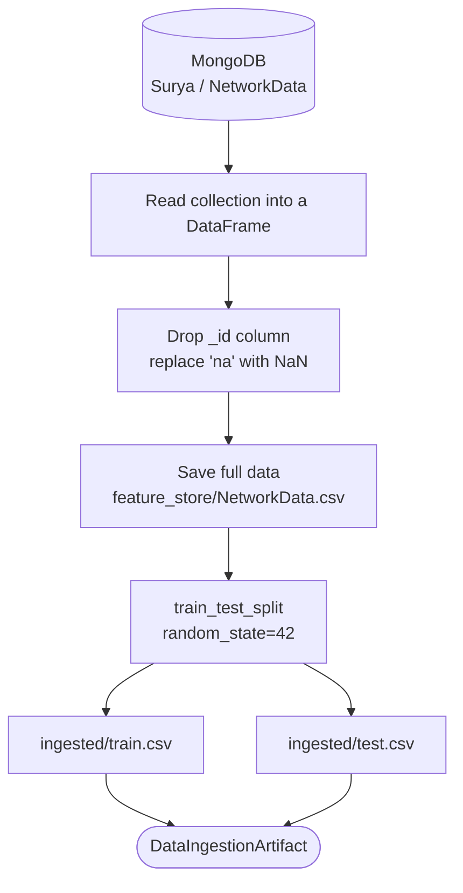
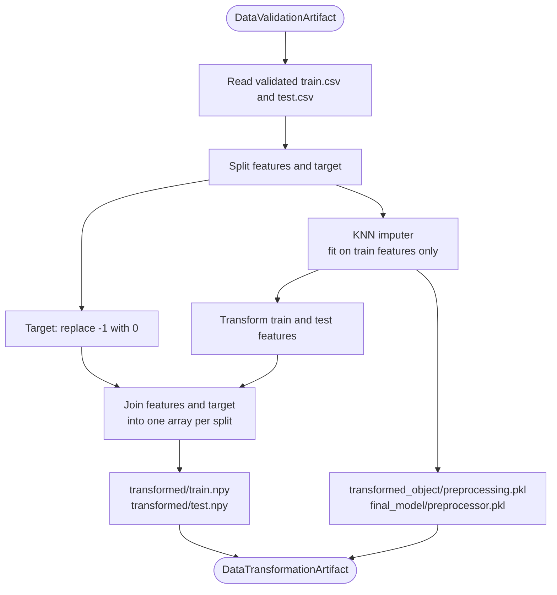

# network-security-mlops
End-to-end MLOps project that detects **phishing websites** from 30 URL/page features (each `-1`, `0` or `1`).

## How it works

```
MongoDB ─> Data ingestion ─> Data validation ─> Data transformation ─> Model training ─> (API: not built yet)
           train/test CSV    schema + drift      KNN imputer, .npy     random search, MLflow
```

| Stage | Status | Code |
|---|---|---|
| Push data to MongoDB | Done | [push_data.py](push_data.py) |
| 1. Data ingestion | Done | [data_ingestion.py](app/components/data_ingestion.py) |
| 2. Data validation (schema + drift) | Done | [data_validation.py](app/components/data_validation.py) |
| 3. Data transformation | Done | [data_transformation.py](app/components/data_transformation.py) |
| 4. Model training (random search + MLflow) | Done | [model_trainer.py](app/components/model_trainer.py) |
| API | Not started | |
| Experiments (EDA, features, models) | Done | [notebooks/](notebooks/) |

Best model so far (from the notebooks): HistGradientBoosting, test F1 0.974 (recall 96.6%, precision 98.2%).

## Quick start

Needs Python >= 3.13, [uv](https://docs.astral.sh/uv/) and a MongoDB database (Atlas or local, see below).

```bash
uv sync                              # 1. install dependencies
cp .env.example .env                 # 2. then put your MongoDB URI in .env
uv run python push_data.py           # 3. load the CSV into MongoDB (once)
uv run python main.py                # 4. run the whole pipeline
```

All commands run from the project root.

## Setup details

### MongoDB
**Option A: Atlas (cloud)**
1. Create a free cluster at https://cloud.mongodb.com.
2. **Database Access:** add a user (username + password).
3. **Network Access:** add your IP (`0.0.0.0/0` for dev only).
4. **Connect, Drivers:** copy the connection string. URL-encode special characters in the password (`@` becomes `%40`).

**Option B: Local**
```bash
docker run -d --name mongo -p 27017:27017 mongo:7
# URI: mongodb://localhost:27017
```

### `.env`
```env
MONGODB_USERNAME=<user>
MONGODB_PASSWORD=<password>
MONGODB_URI=mongodb+srv://<user>:<password>@<cluster>.mongodb.net/?retryWrites=true&w=majority
```
`MONGODB_URI` is the one used to connect. Never commit `.env`.

To log training runs to a remote MLflow server (for example DagsHub), also set the values from [.env.example](.env.example):
```env
MLFLOW_TRACKING_URI=https://dagshub.com/<user>/<repo>.mlflow
MLFLOW_TRACKING_USERNAME=<username>
MLFLOW_TRACKING_PASSWORD=<token>
```
Leave them out to track locally. Settings are read in [app/core/config.py](app/core/config.py).

Check the connection (expect `{'ok': 1.0}`):
```bash
uv run python -c "import pymongo, certifi; from app.core.config import get_settings; print(pymongo.MongoClient(get_settings().mongodb_uri, tlsCAFile=certifi.where()).admin.command('ping'))"
```

### Push data to MongoDB
```bash
uv run python push_data.py
```
Reads `data/phisingData.csv` and inserts every row into database `Surya`, collection `NetworkData` (change the names at the bottom of `push_data.py`). Prints the number of records inserted.

> Running it twice inserts duplicates. Drop the collection first for a clean reload.

Count the documents:
```bash
mongosh "$MONGODB_URI" --eval 'db.getSiblingDB("Surya").NetworkData.countDocuments()'
```

## Run the pipeline

```bash
uv run python main.py
```

This runs ingestion, validation, transformation and model training in order. Progress is printed through the logger and saved to `logs/<date>/<time>.log`. A successful run ends with `Completed model trainer`. Training tunes six models, so it takes longer than the other stages (Gradient Boosting and XGBoost are the slowest).

Run only the first stage on its own:
```bash
uv run python app/components/data_ingestion.py
```

### What each stage does

| Stage | What it does | Output (inside `Artifacts/<timestamp>/`) |
|---|---|---|
| **1. Ingestion** | Reads the MongoDB collection, saves it, splits 80/20 | `data_ingestion/feature_store/NetworkData.csv`, `data_ingestion/ingested/train.csv`, `test.csv` |
| **2. Validation** | Checks the column count against `data_schema/schema.yaml`, then checks data drift. Passing files go to `validated/`, failing files to `invalid/` | `data_validation/validated/` or `invalid/`, `data_validation/drift_report/report.yaml` and `report.html` |
| **3. Transformation** | Maps the target `-1` to `0`, fits a KNN imputer (3 neighbours) on train, applies it to train and test | `data_transformation/transformed/train.npy`, `test.npy`, `transformed_object/preprocessing.pkl` |
| **4. Model training** | Tunes 6 models with `RandomizedSearchCV`, keeps the one with the best test precision, logs it to MLflow, saves it with the imputer | `model_trainer/trained_model/model.pkl` |

The fitted imputer is also saved as `final_model/preprocessor.pkl` for later use at prediction time. `Artifacts/` and `final_model/` are gitignored.

### Stage diagrams

**1. Data ingestion**


**2. Data validation**


**3. Data transformation**


**4. Model trainer**


### Model training (stage 4)
[model_trainer.py](app/components/model_trainer.py) tunes these models: Random Forest, XGBoost, Decision Tree, Gradient Boosting, Logistic Regression and AdaBoost.
- Each model has a search space in `param_distribs`, built from `scipy.stats` distributions (`randint`, `uniform`, `loguniform`) and plain lists.
- [evaluate_models](app/utils/main_utils/utils.py) runs `RandomizedSearchCV` (`n_iter=10`, `cv=3`, scored on precision), refits each model with its best parameters and reports test precision.
- The model with the highest test precision wins. Train and test precision, recall and F1 are computed for it.
- The saved `model.pkl` is a `NetworkModel` that holds the preprocessor and the model, so raw features can go straight into `predict`.

### MLflow tracking
Each training run logs F1, precision and recall, and registers the model as `production_model`. Set the tracking server in `.env` (see below). Without it MLflow writes to a local store (`mlflow.db`, `mlruns/`, both gitignored).

```bash
uv run mlflow ui          # then open http://127.0.0.1:5000
```

### Data drift check (stage 2)
Uses [Evidently](https://github.com/evidentlyai/evidently): train is the reference, test is the current data.
- A column drifts when its Jensen-Shannon distance is >= `0.1`.
- The data counts as drifted if >= 30% of columns drift, **or** if `SSLfinal_State` or `URL_of_Anchor` drifts (the model relies on these two).
- Drift means validation fails and later stages get no valid files.

Open the visual report in a browser:
```bash
xdg-open Artifacts/<timestamp>/data_validation/drift_report/report.html   # macOS: open
```
Thresholds live in [app/constants/training_pipeline/__init__.py](app/constants/training_pipeline/__init__.py).

## Notebooks
Experiments only, no production code. Run them in order. They read and write `Artifacts/notebooks/`.

| Notebook | What it does |
|---|---|
| [01_data_ingestion](notebooks/01_data_ingestion.ipynb) | Load (MongoDB or CSV), check, split |
| [02_eda](notebooks/02_eda.ipynb) | Data quality, target balance, feature vs target |
| [03_feature_engineering](notebooks/03_feature_engineering.ipynb) | Feature ranking, encoding, new features, PCA |
| [04_model_training_tuning](notebooks/04_model_training_tuning.ipynb) | Compare 10 models, tune with `RandomizedSearchCV` |
| [05_model_testing_evaluation](notebooks/05_model_testing_evaluation.ipynb) | Test-set metrics, thresholds, error analysis |
| [08_model_trainer](notebooks/08_model_trainer.ipynb) | Prototype of the trainer: `RandomizedSearchCV` over 5 models |

```bash
uv run jupyter lab notebooks/
```

## Project layout
```
main.py           runs the full pipeline
push_data.py      loads the CSV into MongoDB
app/components/   pipeline stages (ingestion, validation, transformation, model trainer)
app/entity/       config and artifact schemas
app/constants/    constants (paths, drift thresholds, imputer settings)
app/utils/        shared helpers (YAML, numpy, pickle, model evaluation, metrics)
data_schema/      schema.yaml, the expected columns
notebooks/        experiments
docs/             guides
```

## Troubleshooting

| Problem | Fix |
|---|---|
| `ServerSelectionTimeoutError` or SSL error | Check `MONGODB_URI` in `.env` and that your IP is allowed in Atlas Network Access |
| `ImportError ... infer_dtype_from_object` | Evidently does not work with pandas 3. Keep `pandas<3` (already pinned in `pyproject.toml`) and run `uv sync` |
| `TypeError: BaseModel.__init__() takes 1 positional argument` | Pydantic configs take keywords only: `DataIngestionConfig(training_pipeline_config=...)` |
| `FileNotFoundError: data_schema/schema.yaml` | Run from the project root |
| Error shows only "line number [N]" | The real error is in the **first** traceback block. Read it from the top |
| Validation fails with drift | Open `drift_report/report.html` and see which columns moved |
| MLflow UI: `Unexpected token '<', "<!doctype"... is not valid JSON`, server log `cannot import name 'ResolveInfo' from 'graphql'` | `graphene` and `graphql-core` versions clash. Keep `graphene>=3.4,<4` (pinned in `pyproject.toml`), run `uv sync`, restart `mlflow ui` |
| `RecursionError` in a config property | A `@property` is reading itself. Build it from `training_pipeline_config.artifact_dir` instead |

## Docs
- [Logger guide](docs/logger.md)
- [Data drift with Evidently](docs/data_drift_evidently.md)
- [Data ingestion errors explained](docs/data_ingestion_errors.md)
- [Model trainer errors and fixes](docs/model_trainer_debugging.md)
