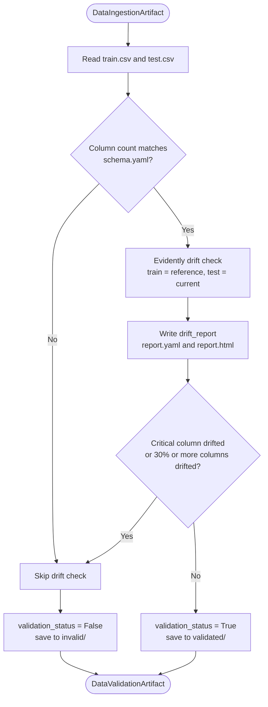
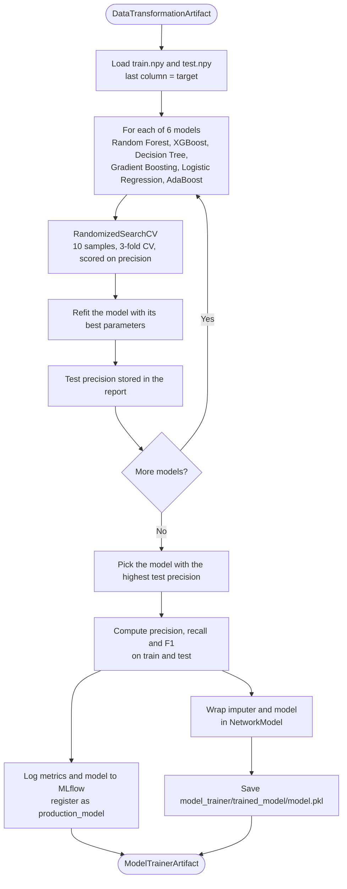
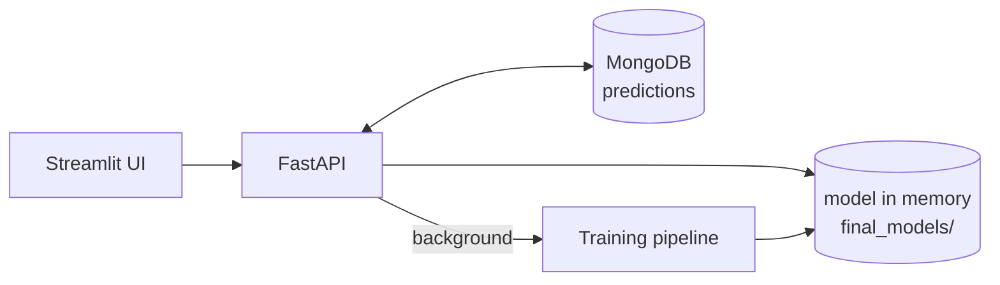

# network-security-mlops
End-to-end MLOps project that detects **phishing websites** from 30 URL/page features (each `-1`, `0` or `1`).

## How it works

```
MongoDB ─> Data ingestion ─> Data validation ─> Data transformation ─> Model training ─> FastAPI ─> Streamlit UI
           train/test CSV    schema + drift      KNN imputer, .npy     random search, MLflow   /predict, /batch, /train
```

| Stage | Status | Code |
|---|---|---|
| Push data to MongoDB | Done | [push_data.py](push_data.py) |
| 1. Data ingestion | Done | [data_ingestion.py](app/components/data_ingestion.py) |
| 2. Data validation (schema + drift) | Done | [data_validation.py](app/components/data_validation.py) |
| 3. Data transformation | Done | [data_transformation.py](app/components/data_transformation.py) |
| 4. Model training (random search + MLflow) | Done | [model_trainer.py](app/components/model_trainer.py) |
| API (predict, batch, history, train) | Done | [app/api/](app/api/) |
| Streamlit UI | Done | [frontend/app.py](frontend/app.py) |
| Experiments (EDA, features, models) | Done | [notebooks/](notebooks/) |

Best model so far (from the notebooks): HistGradientBoosting, test F1 0.974 (recall 96.6%, precision 98.2%). Full comparison, limitations and next steps: [Model performance](#model-performance).

## Quick start

Needs Python >= 3.13, [uv](https://docs.astral.sh/uv/) and a MongoDB database (Atlas or local, see below).

```bash
uv sync                              # 1. install dependencies
cp .env.example .env                 # 2. then put your MongoDB URI in .env
uv run python push_data.py           # 3. load the CSV into MongoDB (once)
uv run python main.py                # 4. run the whole pipeline
```

All commands run from the project root.

### Run the API and UI (after training once)

```bash
uv run uvicorn app.api.main:app --reload   # API   http://localhost:8000  (Swagger: /docs)
uv run streamlit run frontend/app.py       # UI    http://localhost:8501
```

The API loads `final_models/model.pkl` and `final_models/preprocessor.pkl`, which the pipeline writes. Without them `/predict` returns 503; train via the UI's **Train** tab or `POST /train`.

## Setup details

### MongoDB
**Option A: Atlas (cloud)**
1. Create a free cluster at https://cloud.mongodb.com.
2. **Database Access:** add a user (username + password).
3. **Network Access:** add your IP (`0.0.0.0/0` for dev only).
4. **Connect, Drivers:** copy the connection string. URL-encode special characters in the password (`@` becomes `%40`).

**Option B: Local**
```bash
docker run -d --name mongo -p 27017:27017 mongo:7
# URI: mongodb://localhost:27017
```

### `.env`
```env
MONGODB_USERNAME=<user>
MONGODB_PASSWORD=<password>
MONGODB_URI=mongodb+srv://<user>:<password>@<cluster>.mongodb.net/?retryWrites=true&w=majority
```
`MONGODB_URI` is the one used to connect. Never commit `.env`.

To log training runs to a remote MLflow server (for example DagsHub), also set the values from [.env.example](.env.example):
```env
MLFLOW_TRACKING_URI=https://dagshub.com/<user>/<repo>.mlflow
MLFLOW_TRACKING_USERNAME=<username>
MLFLOW_TRACKING_PASSWORD=<token>
```
Leave them out to track locally. Settings are read in [app/core/config.py](app/core/config.py).

Check the connection (expect `{'ok': 1.0}`):
```bash
uv run python -c "import pymongo, certifi; from app.core.config import get_settings; print(pymongo.MongoClient(get_settings().mongodb_uri, tlsCAFile=certifi.where()).admin.command('ping'))"
```

### Push data to MongoDB
```bash
uv run python push_data.py
```
Reads `data/phisingData.csv` and inserts every row into database `Surya`, collection `NetworkData` (change the names at the bottom of `push_data.py`). Prints the number of records inserted.

> Running it twice inserts duplicates. Drop the collection first for a clean reload.

Count the documents:
```bash
mongosh "$MONGODB_URI" --eval 'db.getSiblingDB("Surya").NetworkData.countDocuments()'
```

### AWS S3 (artifact backup)

`TrainingPipeline` (used by `POST /train`) uploads each run to S3: `Artifacts/<timestamp>/` goes to `s3://<bucket>/artifact/<timestamp>/` and `final_models/` goes to `s3://<bucket>/final_model/<timestamp>/`. Unchanged files are skipped. Running `main.py` does **not** upload.

**1. Install and sign in to the AWS CLI** (v2): https://docs.aws.amazon.com/cli/latest/userguide/getting-started-install.html

**2. Create the bucket** (names are global, so `netsecml` may be taken; if so pick another and set `TRAINING_BUCKET_NAME` in `app/constants/training_pipeline/__init__.py`). Names allow lowercase letters, digits and hyphens, not underscores.
```bash
aws s3 mb s3://netsecml --region <your-region>
```
Keep the bucket private (the default).

**3. Create an IAM user for this project** (do not use the root account)
1. AWS Console, IAM, Users, **Create user** (name e.g. `netsec-ml`), no console access.
2. Permissions, **Create policy**, JSON tab, paste this (replace the bucket name if you changed it), name it `netsec-ml-s3`:
```json
{
  "Version": "2012-10-17",
  "Statement": [
    {
      "Sid": "ListBucket",
      "Effect": "Allow",
      "Action": "s3:ListBucket",
      "Resource": "arn:aws:s3:::netsecml"
    },
    {
      "Sid": "ReadWriteObjects",
      "Effect": "Allow",
      "Action": ["s3:GetObject", "s3:PutObject"],
      "Resource": "arn:aws:s3:::netsecml/*"
    }
  ]
}
```
3. Attach `netsec-ml-s3` to the user.
4. User, **Security credentials**, **Create access key**, choose "Command Line Interface", and copy the access key ID and secret (shown once).

`ListBucket` is needed: without it, S3 answers 403 instead of "not found" when the code checks whether a file already exists.

**4. Give the credentials to your machine with `aws configure`**
```bash
aws configure
# AWS Access Key ID:     <paste>
# AWS Secret Access Key: <paste>
# Default region name:   <your-region>   (same region as the bucket)
# Default output format: json
```
This writes `~/.aws/credentials` and `~/.aws/config`. The code uses boto3, which reads the same files, so nothing goes in `.env`. Never commit access keys.

**5. Check it works**
```bash
aws sts get-caller-identity          # shows the IAM user
aws s3 ls s3://netsecml              # empty output is fine; an error is not
```
After a successful `POST /train`, `aws s3 ls s3://netsecml/artifact/` lists the run.

## Run the pipeline

```bash
uv run python main.py
```

This runs ingestion, validation, transformation and model training in order. Progress is printed through the logger and saved to `logs/<date>/<time>.log`. A successful run ends with `Completed model trainer`. Training tunes six models, so it takes longer than the other stages (Gradient Boosting and XGBoost are the slowest).

Run only the first stage on its own:
```bash
uv run python app/components/data_ingestion.py
```

### What each stage does

| Stage | What it does | Output (inside `Artifacts/<timestamp>/`) |
|---|---|---|
| **1. Ingestion** | Reads the MongoDB collection, saves it, splits 80/20 | `data_ingestion/feature_store/NetworkData.csv`, `data_ingestion/ingested/train.csv`, `test.csv` |
| **2. Validation** | Checks the column count against `data_schema/schema.yaml`, then checks data drift. Passing files go to `validated/`, failing files to `invalid/` | `data_validation/validated/` or `invalid/`, `data_validation/drift_report/report.yaml` and `report.html` |
| **3. Transformation** | Maps the target `-1` to `0`, fits a KNN imputer (3 neighbours) on train, applies it to train and test | `data_transformation/transformed/train.npy`, `test.npy`, `transformed_object/preprocessing.pkl` |
| **4. Model training** | Tunes 6 models with `RandomizedSearchCV`, keeps the one with the best test precision, logs it to MLflow, saves it with the imputer | `model_trainer/trained_model/model.pkl` |

The fitted imputer is also saved as `final_models/preprocessor.pkl` (and the best model as `final_models/model.pkl`) for the API to load. `Artifacts/` and `final_models/` are gitignored.

### Stages in plain words

**1. Data ingestion** ([data_ingestion.py](app/components/data_ingestion.py))
- Connects to MongoDB (`Surya` / `NetworkData`) and loads every row into a table.
- Drops the `_id` column and turns the text `na` into a real missing value.
- Saves a full copy, then splits it 80/20 into `train.csv` and `test.csv`.

**2. Data validation** ([data_validation.py](app/components/data_validation.py))
- Checks the number of columns against `data_schema/schema.yaml`.
- Runs an Evidently drift check: has any column's distribution moved between train and test?
- Good files go to `validated/`, bad ones to `invalid/`; a drift report is saved either way.

**3. Data transformation** ([data_transformation.py](app/components/data_transformation.py))
- Changes the target from `-1` to `0` (0 = phishing, 1 = legitimate).
- Fits a KNN imputer on train only, then fills gaps in train and test with it.
- Saves the arrays as `.npy` and the imputer as `preprocessing.pkl` (copy in `final_models/`).

**4. Model trainer** ([model_trainer.py](app/components/model_trainer.py))
- Tunes 6 models with random search (5 random settings each, 3-fold cross-validation).
- Keeps the model with the best test precision and logs it, plus metrics, to MLflow.
- Saves it with the imputer to `model_trainer/trained_model/model.pkl`; raw model to `final_models/model.pkl`.

**Training pipeline** ([training_pipeline.py](app/pipeline/training_pipeline.py))
- Runs the four stages in order and hands each stage's output to the next.
- Wraps any failure in `NetworkSecurityException` with the file and line.
- When training finishes, uploads `Artifacts/<timestamp>/` and `final_models/` to S3.
- This is what `POST /train` runs; `main.py` runs the same stages without the S3 upload.

### Stage diagrams

**1. Data ingestion**


**2. Data validation**


**3. Data transformation**


**4. Model trainer**


### Model training (stage 4)
[model_trainer.py](app/components/model_trainer.py) tunes these models: Random Forest, XGBoost, Decision Tree, Gradient Boosting, Logistic Regression and AdaBoost.
- Each model has a search space in `param_distribs`, built from `scipy.stats` distributions (`randint`, `uniform`, `loguniform`) and plain lists.
- [evaluate_models](app/utils/main_utils/utils.py) runs `RandomizedSearchCV` (`n_iter=10`, `cv=3`, scored on precision), refits each model with its best parameters and reports test precision.
- The model with the highest test precision wins. Train and test precision, recall and F1 are computed for it.
- The saved `model.pkl` is a `NetworkModel` that holds the preprocessor and the model, so raw features can go straight into `predict`.

### MLflow tracking
Each training run logs F1, precision and recall, and registers the model as `production_model`. Set the tracking server in `.env` (see below). Without it MLflow writes to a local store (`mlflow.db`, `mlruns/`, both gitignored).

```bash
uv run mlflow ui          # then open http://127.0.0.1:5000
```

### Data drift check (stage 2)
Uses [Evidently](https://github.com/evidentlyai/evidently): train is the reference, test is the current data.
- A column drifts when its Jensen-Shannon distance is >= `0.1`.
- The data counts as drifted if >= 30% of columns drift, **or** if `SSLfinal_State` or `URL_of_Anchor` drifts (the model relies on these two).
- Drift means validation fails and later stages get no valid files.

Open the visual report in a browser:
```bash
xdg-open Artifacts/<timestamp>/data_validation/drift_report/report.html   # macOS: open
```
Thresholds live in [app/constants/training_pipeline/__init__.py](app/constants/training_pipeline/__init__.py).

## Model performance

Results from the experiment notebooks ([04](notebooks/04_model_training_tuning.ipynb) tuning, [05](notebooks/05_model_testing_evaluation.ipynb) testing). I recomputed the test scores below from the saved tuned models and they match the notebook output.

**Data:** 11,055 rows, 30 features (each `-1`, `0` or `1`), 4,898 phishing (44.3%) and 6,157 legitimate (55.7%). Stratified 80/20 split with `random_state=42`: 8,844 train rows and 2,211 test rows (980 phishing, 1,231 legitimate). In these tables **phishing is the positive class**, so recall means "how many phishing sites we caught".

### 1. Held-out test results (tuned models, sorted by F1)

| Model | Accuracy | Precision | Recall | **F1** | ROC AUC | MCC | Train-test F1 gap |
|---|---|---|---|---|---|---|---|
| **HistGradientBoosting** | 0.9774 | 0.9824 | 0.9663 | **0.9743** | 0.9977 | 0.9542 | 0.0144 |
| ExtraTrees | 0.9769 | 0.9834 | 0.9643 | 0.9737 | 0.9983 | 0.9533 | 0.0146 |
| Voting ensemble (top 3) | 0.9760 | 0.9813 | 0.9643 | 0.9727 | 0.9983 | 0.9515 | 0.0160 |
| RandomForest | 0.9751 | 0.9803 | 0.9633 | 0.9717 | 0.9980 | 0.9496 | 0.0170 |
| GradientBoosting | 0.9715 | 0.9751 | 0.9602 | 0.9676 | 0.9970 | 0.9423 | 0.0132 |
| LogisticRegression | 0.9394 | 0.9425 | 0.9194 | 0.9308 | 0.9885 | 0.8771 | 0.0016 |

### 2. Starting point: ten models with default settings (5-fold CV on the training set)

| Model | F1 | ROC AUC | Fit time (s) |
|---|---|---|---|
| ExtraTrees | 0.9683 | 0.9909 | 0.29 |
| MLP | 0.9665 | 0.9960 | 7.42 |
| RandomForest | 0.9650 | 0.9945 | 0.30 |
| HistGradientBoosting | 0.9610 | 0.9955 | 0.28 |
| DecisionTree | 0.9568 | 0.9704 | 0.01 |
| SVC (rbf) | 0.9483 | 0.9909 | 1.56 |
| KNN | 0.9458 | 0.9882 | 0.05 |
| GradientBoosting | 0.9398 | 0.9895 | 0.50 |
| LogisticRegression | 0.9302 | 0.9862 | 0.11 |
| AdaBoost | 0.9195 | 0.9837 | 0.18 |

Random search lifted HistGradientBoosting from 0.9610 to 0.9687 (CV F1) and GradientBoosting from 0.9398 to 0.9653. The tree ensembles beat the linear and distance-based models by about 3 F1 points.

### 3. Best model: HistGradientBoosting

Selected by cross-validated F1 (0.9687), then confirmed on the test set.

| | |
|---|---|
| Test F1 / precision / recall | **0.9743** / 0.9824 / 0.9663 |
| Phishing sites caught / missed | 947 / 33 |
| False alarms (legitimate flagged as phishing) / correct legitimate | 17 / 1,214 |
| 95% bootstrap interval for F1 | 0.9670 to 0.9810 |

The decision threshold trades missed phishing against false alarms (default is 0.5):

| Threshold | Precision | Recall | F1 | Missed phishing | False alarms |
|---|---|---|---|---|---|
| 0.3 | 0.964 | 0.979 | 0.971 | 21 | 36 |
| **0.5** | **0.982** | **0.966** | **0.974** | 33 | 17 |
| 0.7 | 0.994 | 0.952 | 0.972 | 47 | 6 |

**The top three models are statistically tied.** HistGradientBoosting beat ExtraTrees in only 63% of bootstrap resamples, and their intervals overlap almost completely. Treat "HistGradientBoosting is best" as "it is among the best", and pick on other grounds too: simplicity, speed, and probability quality (it has the lowest log loss of the single models, 0.0609).

### 4. What the production pipeline picks

`uv run python main.py` (or `POST /train`) runs its own search and chooses the model with the best **test precision** among six models:

| Pipeline run | Selected model | Test precision | Test F1 / recall |
|---|---|---|---|
| Larger search space (Nov 23) | XGBoost | 0.9731 | not in the logs I checked |
| Trimmed search, 5 iterations (Nov 25) | Random Forest | 0.9647 | 0.9719 / 0.9793 |

Two things to know before comparing these with section 1: the pipeline's positive class is **legitimate** (it maps `-1` to `0`, so `1` means legitimate), so its precision and recall describe a different class; and it uses a non-stratified split, so its test set differs from the notebooks'. HistGradientBoosting and ExtraTrees are not in the pipeline's model list yet, so **a model trained by the pipeline (and then served by the API) is not the notebook winner.**

## Limitations

- **Duplicate rows inflate the scores a little.** 47.1% of the dataset's rows are exact duplicates of another row, and 65.8% of the test rows also appear in the training set. Accuracy is 0.9801 on those seen rows and 0.9722 on unseen ones (F1 0.9762 on unseen). The gap is small, but the headline numbers are somewhat optimistic.
- **The leading models are within noise** (see the bootstrap result above), and every figure comes from **one split of one dataset**. There is no external or time-based validation, so I can't say how it performs on phishing sites from today.
- **The pipeline selects on the test set**, and by precision. That leaks information from the test set into the choice, and precision is the wrong thing to optimise first when a missed phishing site costs more than a false alarm.
- **The shorter search lowered the pipeline's score.** After I shrank the search for speed, the pipeline's best test precision dropped from 0.9731 to 0.9647, and the winner changed from XGBoost to Random Forest. This is consistent with a weaker search, but I did not isolate it as the only cause.
- **The features are not extracted from a URL.** The model takes 30 ready-made indicators, so the system can't yet scan a real link end to end.
- **Static data.** Phishing changes quickly. No drift against newer sites has been measured, and I don't know the dataset's collection date.
- **Uncertain cases are weak.** Predictions with probability between 0.35 and 0.65 (37 test rows) were right only 62.2% of the time, versus 98.3% for confident ones. The probabilities are not calibrated.
- **Small tuning budget.** Random search used a few settings per model, so tuned scores may leave something on the table.
- **Nothing else is measured:** latency, cost per prediction, robustness to a deliberate attacker, and behaviour on missing or malformed features.

## Future improvements

1. **Clean the evaluation:** remove duplicate rows before splitting (or split by group), and add a time-based and an external test set.
2. **Fix the selection in the pipeline:** choose by cross-validated F1 or recall with phishing as the positive class, never on the test set; add HistGradientBoosting and ExtraTrees; log the full per-model table to MLflow instead of only the winner.
3. **Choose the threshold by cost:** set a recall target (for example, at most 20 missed phishing sites per 1,000) and pick the threshold from it.
4. **Calibrate the probabilities** (isotonic or Platt) and send uncertain cases to a human.
5. **Run a bigger search off the small server,** then compare against the quick search with confidence intervals.
6. **Extract the 30 features from a live URL** in a sandboxed fetcher, and measure accuracy on freshly collected phishing sites (see [docs/agentic_ai_roadmap.md](docs/agentic_ai_roadmap.md)).
7. **Monitor drift on live predictions** and retrain when it passes a threshold, with a human approving the promotion.
8. **Explain predictions** (SHAP) and test robustness to feature tampering.

## Run with Docker

```bash
cp .env.example .env            # then fill in your values (KEY=value, no spaces around =)
docker compose -f docker-compose.local.yml up --build   # UI http://localhost:8501, API http://localhost:8000/docs
```

Two small images (backend, frontend) and a compose file for local development. MongoDB stays on Atlas (cloud URI from `.env`). Explained step by step in [docs/docker_images.md](docs/docker_images.md) and [docs/docker_compose.md](docs/docker_compose.md). The plain `docker-compose.yml` is the AWS stack: see [docs/aws_deployment.md](docs/aws_deployment.md). A plain `uv sync` still installs everything for local work. Docker installs only what each image needs.

## API and UI

| Endpoint | What it does |
|---|---|
| `GET /health` | MongoDB, MLflow and model status (checked in parallel) |
| `POST /predict` | JSON `{"records":[{30 features}]}` returns `phishing` or `legitimate` per record, and logs to MongoDB |
| `GET /predictions?limit=&skip=` | Logged prediction history, newest first |
| `POST /batch/predict` | Upload a CSV, get back the same rows plus `prediction` and `label` |
| `POST /train`, `GET /train/status` | Run the full pipeline in the background, then hot-reload the model |



Label `1` = legitimate, `0` = phishing. The API is async: blocking sklearn work runs in threads, and independent DB/network calls run in parallel with `asyncio.gather`. Use **one** uvicorn worker (training status is kept in memory). Set `API_URL` if the UI should call a different API address.

New to FastAPI? Read [docs/fastapi_backend.md](docs/fastapi_backend.md).

## Tests

```bash
uv run pytest                       # 56 checks, about 2 s, no network or cloud needed
uv run ruff check app/api tests     # lint
```

Unit tests, API integration tests (fake MongoDB, tiny real model) and a lint check. Details in [docs/testing.md](docs/testing.md).

## Notebooks
Experiments only, no production code. Run them in order. They read and write `Artifacts/notebooks/`.

| Notebook | What it does |
|---|---|
| [01_data_ingestion](notebooks/01_data_ingestion.ipynb) | Load (MongoDB or CSV), check, split |
| [02_eda](notebooks/02_eda.ipynb) | Data quality, target balance, feature vs target |
| [03_feature_engineering](notebooks/03_feature_engineering.ipynb) | Feature ranking, encoding, new features, PCA |
| [04_model_training_tuning](notebooks/04_model_training_tuning.ipynb) | Compare 10 models, tune with `RandomizedSearchCV` |
| [05_model_testing_evaluation](notebooks/05_model_testing_evaluation.ipynb) | Test-set metrics, thresholds, error analysis |
| [08_model_trainer](notebooks/08_model_trainer.ipynb) | Prototype of the trainer: `RandomizedSearchCV` over 5 models |

```bash
uv run jupyter lab notebooks/
```

## Project layout
```
main.py           runs the full pipeline
app/api/          FastAPI backend (main, schemas, deps, routes/)
app/pipeline/     training_pipeline.py, batch_pipeline.py (batch scoring)
app/cloud/        s3_syncer.py (boto3 upload/download of folders)
frontend/         Streamlit UI
push_data.py      loads the CSV into MongoDB
app/components/   pipeline stages (ingestion, validation, transformation, model trainer)
app/entity/       config and artifact schemas
app/constants/    constants (paths, drift thresholds, imputer settings)
app/utils/        shared helpers (YAML, numpy, pickle, model evaluation, metrics)
data_schema/      schema.yaml, the expected columns
notebooks/        experiments
docs/             guides
```

## Troubleshooting

| Problem | Fix |
|---|---|
| `ServerSelectionTimeoutError` or SSL error | Check `MONGODB_URI` in `.env` and that your IP is allowed in Atlas Network Access |
| `ImportError ... infer_dtype_from_object` | Evidently does not work with pandas 3. Keep `pandas<3` (already pinned in `pyproject.toml`) and run `uv sync` |
| `TypeError: BaseModel.__init__() takes 1 positional argument` | Pydantic configs take keywords only: `DataIngestionConfig(training_pipeline_config=...)` |
| `FileNotFoundError: data_schema/schema.yaml` | Run from the project root |
| Error shows only "line number [N]" | The real error is in the **first** traceback block. Read it from the top |
| Validation fails with drift | Open `drift_report/report.html` and see which columns moved |
| MLflow UI: `Unexpected token '<', "<!doctype"... is not valid JSON`, server log `cannot import name 'ResolveInfo' from 'graphql'` | `graphene` and `graphql-core` versions clash. Keep `graphene>=3.4,<4` (pinned in `pyproject.toml`), run `uv sync`, restart `mlflow ui` |
| `/predict` returns 503 "Model not loaded" | `final_models/` is empty. Run `uv run python main.py` or `POST /train` |
| Streamlit shows "Cannot reach API" | Start the API first, or set `API_URL` |
| `/train` fails at import with a DagsHub error | Check `DAGSHUB_REPO_OWNER`/`DAGSHUB_REPO_NAME` in `.env` |
| `NoCredentialsError: Unable to locate credentials` | Run `aws configure` (or set `AWS_ACCESS_KEY_ID` / `AWS_SECRET_ACCESS_KEY`) |
| S3 `AccessDenied` or `403` on upload | Check the IAM policy has `s3:ListBucket` on the bucket and `s3:GetObject`/`s3:PutObject` on `bucket/*`, and the bucket name matches `TRAINING_BUCKET_NAME` |
| S3 `NoSuchBucket` or `BucketAlreadyExists` | Create the bucket (names are global, pick a unique one) and update `TRAINING_BUCKET_NAME` |
| `RecursionError` in a config property | A `@property` is reading itself. Build it from `training_pipeline_config.artifact_dir` instead |

## Docs
- [FastAPI backend explained](docs/fastapi_backend.md)
- [Testing guide: unit, integration, lint](docs/testing.md)
- [AWS deployment (ECR, EC2, GitHub Actions)](docs/aws_deployment.md)
- [The CI/CD workflow explained](docs/cicd_explained.md)
- [Docker images explained](docs/docker_images.md)
- [docker-compose explained](docs/docker_compose.md)
- [Agentic AI roadmap](docs/agentic_ai_roadmap.md)
- [Logger guide](docs/logger.md)
- [Data drift with Evidently](docs/data_drift_evidently.md)
- [Data ingestion errors explained](docs/data_ingestion_errors.md)
- [Model trainer errors and fixes](docs/model_trainer_debugging.md)
