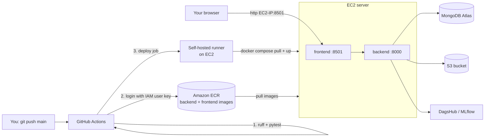

# Deploying to AWS (step by step)

Every push to `main` is tested, built into two Docker images, stored in AWS, and started on one EC2 server. This guide lists **exactly what you click in the AWS dashboard** the first time, and what the automation does afterwards.

> This guide is written for the **AWS Free Plan** (accounts created on or after July 15, 2025). See [Free Tier notes](#free-tier-notes-read-this-first) before you launch anything.
>
> Replace `<REGION>` (for example `ap-southeast-1`) and `<ACCOUNT_ID>` (12 digits, top-right menu in the console) everywhere. **Use the same region for every AWS service below.**

## 1. The big picture



| Piece | What it is for |
|---|---|
| **ECR** (Elastic Container Registry) | A private storage place for Docker images. One repository per image |
| **IAM user** | The identity GitHub uses to push images to ECR. Its access key is stored in GitHub secrets, and the permissions are attached directly to the user |
| **EC2** | The server (a rented computer) that runs the containers |
| **Instance role** | Gives the EC2 server its own permissions (pull from ECR, use S3). No keys on the server |
| **Self-hosted runner** | A small program on the EC2 that lets GitHub run the deploy step on that server |
| **Security group** | The firewall: which ports and which IP addresses may connect |

### What the workflow does ([cicd.yaml](../.github/workflows/cicd.yaml))

A line-by-line explanation is in [cicd_explained.md](cicd_explained.md).

| Job | When | Does |
|---|---|---|
| `integration` | every push and pull request | `uv sync`, `ruff`, `pytest` |
| `build-and-push-ecr-image` | push to `main`, after tests pass | logs in with the IAM user's key, builds backend and frontend images, tags each with `latest` and the git commit SHA, pushes to ECR |
| `Continuous-Deployment` | push to `main`, after the build | Runs on the EC2 self-hosted runner: logs in to ECR, downloads the newest model from S3 if the server has none ([fetch_latest_model.sh](../scripts/fetch_latest_model.sh)), `docker compose pull`, `docker compose up -d`, waits for `/health`, deletes old images |

The compose file used on the server is [docker-compose.yml](../docker-compose.yml). Local development uses `docker-compose.local.yml`.

### Free Tier notes (read this first)

**What "free" means now.** AWS's new Free Plan gives new accounts up to about **$200 in credits** and lasts about **6 months** (credits expire 6 months after you create the account). Usage that is "free tier eligible" draws the credit balance down; it is not a separate monthly allowance. When the credits or the 6 months run out, AWS bills you unless you upgrade the plan on purpose. Check the exact amounts and your expiry date in the console under **Billing and Cost Management, Free Tier**.

**Pick a server that fits in memory.** I measured this project on my machine: the API uses about **280 MB** of RAM after scoring a 2000-row CSV (peak 284 MB), and an idle Streamlit server about **70 MB** (it grows with every open browser tab). On the server you also need Docker itself, the GitHub runner and the operating system, so the totals below are estimates, not measurements.

| Instance type (Free Plan eligible) | RAM | Verdict |
|---|---|---|
| `t3.micro` | 1 GB | Probably too tight once Docker, the runner and the OS are counted. Only try it with 2 GB swap |
| **`t3.small`** | **2 GB** | **Recommended**, with 2 GB swap (steps below) |
| `c7i-flex.large` | 4 GB | Comfortable. Burns credits faster |
| `m7i-flex.large` | 8 GB | Only needed to train on the server. Burns credits fastest |

The launch wizard marks eligible types with **Free tier eligible**. Choose one with that label; availability differs by region.

**Do not train on the server.** Training needs far more memory and time than a free-tier box has. Train on your own computer: the pipeline uploads the new model to S3, and the deploy job downloads the newest one to the server automatically when the server has none.

**Keep the bill near zero**
- Keep only **3 images** per ECR repository (lifecycle policy in Step 1). ECR's free storage is small (500 MB a month for 12 months on the older plan), and one backend image is over 1 GB uncompressed, so you may pay a little for ECR storage.
- Use a **20 GiB** disk. The deploy job deletes old images on every run so the disk does not fill up.
- AWS bills **every public IPv4 address per hour** (about $0.005 an hour, roughly $3.65 a month). An Elastic IP attached to a running server costs the same as the automatic public IP. An Elastic IP that is **not** attached to a running instance is billed too, so release it when you stop using the server.
- Create a **budget alert** (Step 7) so you hear about charges early.
- Stopping the instance pauses the compute charge but not the disk. To stop all charges, follow the cleanup in Section 8.

Sources: [AWS Free Tier FAQs](https://aws.amazon.com/free/faqs/), [EC2 Free Tier usage](https://docs.aws.amazon.com/AWSEC2/latest/UserGuide/ec2-free-tier-usage.html), [ECR pricing](https://aws.amazon.com/ecr/pricing/), [public IPv4 charge announcement](https://aws.amazon.com/blogs/aws/new-aws-public-ipv4-address-charge-public-ip-insights/). Prices and eligible types change, so confirm on those pages.

*Older account (created before July 15, 2025)?* You are on the 12-month Free Tier: 750 hours a month of `t2.micro` or `t3.micro` (1 GB RAM). That is the "probably too tight" row above, so use swap and do not train on the server.

## 2. Do this once in the AWS console

Tick each box as you go.

### Step 1. Create two ECR repositories
- [ ] Console, search **ECR**, **Create repository**.
- [ ] Visibility: **Private**. Name: `network-security-backend`. Leave tag immutability **disabled** (we reuse the `latest` tag). Create.
- [ ] Repeat with the name `network-security-frontend`.
- [ ] **Recommended on the Free Plan:** open each repository, **Lifecycle policies**, **Create rule**: rule priority 1, image status **Any**, match criteria **Image count more than** `3`, action **expire**. This keeps ECR storage (and cost) small.

### Step 2. Create an IAM user for GitHub (attach policies directly)
GitHub needs an AWS identity to push images. We create one **IAM user** and give it permissions by **attaching a policy directly** to it.

**2a. Create the policy**
- [ ] Console, **IAM**, **Policies**, **Create policy**, **JSON** tab, paste the policy below, **Next**.
- [ ] Name it `ecr-push-network-security`, **Create policy**.
```json
{
  "Version": "2012-10-17",
  "Statement": [
    {
      "Sid": "LoginToEcr",
      "Effect": "Allow",
      "Action": "ecr:GetAuthorizationToken",
      "Resource": "*"
    },
    {
      "Sid": "PushToTheTwoRepositories",
      "Effect": "Allow",
      "Action": [
        "ecr:BatchCheckLayerAvailability",
        "ecr:InitiateLayerUpload",
        "ecr:UploadLayerPart",
        "ecr:CompleteLayerUpload",
        "ecr:PutImage"
      ],
      "Resource": [
        "arn:aws:ecr:<REGION>:<ACCOUNT_ID>:repository/network-security-backend",
        "arn:aws:ecr:<REGION>:<ACCOUNT_ID>:repository/network-security-frontend"
      ]
    }
  ]
}
```
It lets the user log in to ECR and push images to **only the two repositories** you created, and nothing else.

**2b. Create the user**
- [ ] IAM, **Users**, **Create user**. User name: `github-actions-ecr-push`.
- [ ] Leave **Provide user access to the AWS Management Console** **unticked** (this user is for GitHub only, it never logs in to the console). **Next**.
- [ ] Permissions options: choose **Attach policies directly**.
- [ ] In the list, search for `ecr-push-network-security` and tick it. **Next**, then **Create user**.

*Quicker but broader:* instead of your own policy, tick the AWS-managed policy `AmazonEC2ContainerRegistryPowerUser`. It works, but it covers every ECR repository in the account.

**2c. Create the access key**
- [ ] Open the user, tab **Security credentials**, **Create access key**.
- [ ] Use case: **Third-party service** (or **Application running outside AWS**), tick the confirmation box, **Next**, **Create access key**.
- [ ] **Copy the Access key ID and the Secret access key now.** The secret is shown only once. You paste both into GitHub in Section 4. Do not keep them in any other place, and do not commit them.

**Keep this key safe**
- It is a long-lived password. Anyone who has it can push images to your two repositories, which is why the policy is so small.
- GitHub stores secrets encrypted and hides them in logs, but any workflow that someone with write access to the repository adds can use them. Keep repository write access limited.
- Rotate it about every 90 days (create a new key, update the GitHub secrets, delete the old key). If it ever leaks: IAM, the user, **Security credentials**, **Deactivate**, then **Delete**.
- The **Last used** column on that page shows when the key was used, which is a quick way to spot a key you forgot about.
- Later, you can swap to short-lived credentials (OIDC) so no key is stored at all. See the last section.

### Step 3. Create the EC2 server's own role
- [ ] IAM, **Roles**, **Create role**, trusted entity **AWS service**, use case **EC2**. Next.
- [ ] Skip policies, name it `netsec-ec2-role`, create.
- [ ] Open it, **Add permissions**, **Create inline policy**, JSON, name it `ecr-pull-and-s3`:
```json
{
  "Version": "2012-10-17",
  "Statement": [
    {
      "Sid": "LoginToEcr",
      "Effect": "Allow",
      "Action": "ecr:GetAuthorizationToken",
      "Resource": "*"
    },
    {
      "Sid": "PullImages",
      "Effect": "Allow",
      "Action": ["ecr:BatchGetImage", "ecr:GetDownloadUrlForLayer", "ecr:BatchCheckLayerAvailability"],
      "Resource": [
        "arn:aws:ecr:<REGION>:<ACCOUNT_ID>:repository/network-security-backend",
        "arn:aws:ecr:<REGION>:<ACCOUNT_ID>:repository/network-security-frontend"
      ]
    },
    {
      "Sid": "ListTrainingBucket",
      "Effect": "Allow",
      "Action": "s3:ListBucket",
      "Resource": "arn:aws:s3:::<TRAINING_BUCKET_NAME>"
    },
    {
      "Sid": "ReadWriteTrainingObjects",
      "Effect": "Allow",
      "Action": ["s3:GetObject", "s3:PutObject"],
      "Resource": "arn:aws:s3:::<TRAINING_BUCKET_NAME>/*"
    }
  ]
}
```
`<TRAINING_BUCKET_NAME>` is the bucket in your `.env` (the one the training pipeline uploads to).

### Step 4. Launch the EC2 server
- [ ] Console, **EC2**, **Launch instance**.
- [ ] Name: `network-security`.
- [ ] Image: **Ubuntu Server 24.04 LTS**.
- [ ] Instance type: **t3.small** (2 GB RAM), labelled **Free tier eligible**. See the table in the Free Tier notes. Do not plan to train on the server.
- [ ] Key pair: create or choose one (you need it to log in over SSH).
- [ ] Network settings, **Create security group**. Inbound rules:

| Type | Port | Source | Why |
|---|---|---|---|
| SSH | 22 | **My IP** | You log in to set things up |
| Custom TCP | 8501 | **My IP** | The web UI |

  **Do not open port 8000.** The API is only used by the UI on the same server. **Do not use "Anywhere (0.0.0.0/0)"** for 8501: the UI has no login.
- [ ] Storage: **20 GiB gp3**. Two images plus the system fit easily, and the deploy job removes old images.
- [ ] **Advanced details**:
  - **IAM instance profile**: `netsec-ec2-role`.
  - **Metadata version**: `V2 only (token required)`.
  - **Metadata response hop limit**: `2`. This one matters: with the default of 1, programs inside Docker containers cannot read the instance role, and S3 uploads fail with `NoCredentialsError`.
- [ ] **Launch instance**.

### Step 5. Give the server a fixed address
- [ ] EC2, **Elastic IPs**, **Allocate Elastic IP address**, Allocate.
- [ ] Select it, **Actions**, **Associate Elastic IP address**, choose your instance.

Without this the public IP changes every time the server is stopped and started, which breaks the Atlas allow-list and your bookmark. AWS bills public IPv4 addresses per hour either way (see the Free Tier notes), and an Elastic IP that is not attached to a running instance is billed too. Release it when you are done.

### Step 6. Allow the server to reach MongoDB Atlas
- [ ] Atlas, your project, **Security**, **Network Access**, **Add IP Address**.
- [ ] Enter the Elastic IP, comment `EC2 network-security`, Confirm.

### Step 7. Get an email before you are charged
- [ ] Console, **Billing and Cost Management**, **Budgets**, **Create budget**.
- [ ] Choose the **Zero spend budget** template, enter your email, create it. You get an email as soon as any spend appears.
- [ ] Also open **Free Tier** in the same menu now and write down your credit balance and expiry date.

## 3. Set up the server (once, over SSH)

Connect (from your computer):
```bash
ssh -i your-key.pem ubuntu@<ELASTIC_IP>
```

**Install Docker and the AWS CLI**
```bash
curl -fsSL https://get.docker.com | sudo sh
sudo usermod -aG docker $USER        # lets you run docker without sudo
sudo apt-get install -y unzip curl
curl "https://awscli.amazonaws.com/awscli-exe-linux-x86_64.zip" -o awscliv2.zip   # official installer
unzip -q awscliv2.zip && sudo ./aws/install
exit                                  # log out and back in so the docker group applies
```
Log in again, then add **2 GB of swap** (disk space used as emergency memory, so a busy moment does not kill the containers):
```bash
sudo fallocate -l 2G /swapfile && sudo chmod 600 /swapfile
sudo mkswap /swapfile && sudo swapon /swapfile
echo '/swapfile none swap sw 0 0' | sudo tee -a /etc/fstab
free -h      # the Swap line should show 2.0Gi
```
Then check:
```bash
docker --version && docker compose version
aws sts get-caller-identity           # should show the role netsec-ec2-role, no keys needed
```

**Create the app folder and its secrets file**
```bash
sudo mkdir -p /opt/netsec && sudo chown $USER:$USER /opt/netsec
cd /opt/netsec && mkdir -p final_models Artifacts logs
nano .env                             # paste the values below, save
chmod 600 .env
```
`/opt/netsec/.env` (same names as your local `.env`, plus the region; **no AWS keys**):
```
MONGODB_USERNAME=...
MONGODB_PASSWORD=...
MONGODB_URI=...
MLFLOW_URI=...
DAGSHUB_REPO_OWNER=...
DAGSHUB_REPO_NAME=...
DAGSHUB_USER_TOKEN=...
TRAINING_BUCKET_NAME=...
AWS_DEFAULT_REGION=<REGION>
```
Write each line as `KEY=value` with no spaces around `=`. This file stays on the server and is never committed.

The containers run as user ID 1000, the same as the default `ubuntu` user, so they can write to these folders.

### Register the self-hosted runner

The runner is a small program on the EC2 server. It keeps an outbound connection to GitHub and waits for jobs. When the deploy job starts, GitHub hands it to this program, which runs the steps on the server. Nothing needs to be opened in the security group for it, because the server calls out to GitHub.

**1. Get a registration token from GitHub** (in the browser)
- [ ] Repository, **Settings**, **Actions**, **Runners**, **New self-hosted runner**.
- [ ] Choose **Linux** and **x64** (choose **ARM64** only if you launched a `t4g` instance).
- [ ] Copy the token from the `./config.sh --url ... --token ...` line. It is valid for about an hour and works once. If it expires, reload the page for a new one.

**2. Install the runner on the server** (SSH in as the normal `ubuntu` user. **Never use `sudo` or root** for `config.sh`: it refuses to run that way)

GitHub shows the exact, current commands on that page, and they change with every runner release, so prefer to copy them from there. At the time of writing they look like this:
```bash
mkdir -p ~/actions-runner && cd ~/actions-runner

# download (x64). Check the page for the newest version number
RUNNER_VERSION=2.338.2
curl -fsSL -o actions-runner.tar.gz \
  https://github.com/actions/runner/releases/download/v${RUNNER_VERSION}/actions-runner-linux-x64-${RUNNER_VERSION}.tar.gz

# verify the download is not corrupted or tampered with (the hash is listed on the release page)
echo "baebf204307bac6193480852732f0aba2ae97b6c5597c244f4d5558390147c40  actions-runner.tar.gz" | sha256sum -c -

tar xzf actions-runner.tar.gz
sudo ./bin/installdependencies.sh      # system libraries the runner needs (once)
```
For ARM64 use `actions-runner-linux-arm64-...` and the matching hash from the [release page](https://github.com/actions/runner/releases).

**3. Connect it to your repository**
```bash
./config.sh --url https://github.com/jsuryanm/network-security-mlops \
            --token <REGISTRATION_TOKEN> \
            --name netsec-ec2 \
            --unattended
```
- `--name` is the label you will see in GitHub. `--unattended` skips the questions and accepts the defaults (default runner group, work folder `_work`).
- The workflow uses `runs-on: self-hosted`. Every self-hosted runner automatically has the labels `self-hosted`, `Linux` and `X64`, so no extra label is needed.

**4. Run it as a service so it survives reboots**
```bash
sudo ./svc.sh install       # creates a systemd service that runs as your current user
sudo ./svc.sh start
sudo ./svc.sh status        # should say "active (running)"
```
Back on GitHub, **Settings, Actions, Runners** should show `netsec-ec2` as **Idle** with a green dot. That means it is ready for the deploy job.

**5. Make sure the runner can use Docker**

The deploy job runs `docker compose`, so the runner's user must be in the `docker` group (you did this in the Docker install step). If you added it **after** starting the service, restart the service so it picks up the group:
```bash
groups                                   # the list must include "docker"
sudo ./svc.sh stop && sudo ./svc.sh start
```

**Manage the runner**

| Task | Command (in `~/actions-runner`) |
|---|---|
| Is it running? | `sudo ./svc.sh status` |
| Stop / start / restart | `sudo ./svc.sh stop`, `sudo ./svc.sh start` |
| Read its logs | `journalctl -u 'actions.runner.*' -n 100 --no-pager` |
| Watch a job's output on the server | Open the run on GitHub, or `ls ~/actions-runner/_diag` for the runner's own log files |
| Remove it for good | `sudo ./svc.sh stop && sudo ./svc.sh uninstall`, then `./config.sh remove --token <REMOVAL_TOKEN>` (GitHub, Settings, Actions, Runners, the runner's menu, **Remove**, shows the token) |
| Update it | Nothing to do: the runner updates itself when GitHub releases a new version |

The runner program is idle most of the time. I did not measure its memory use on a server, so watch `free -h` on the 2 GB instance after the first deploys.

> **Security:** a self-hosted runner executes code on your server, and that server holds your `.env` secrets and the instance role. The deploy job only runs for pushes to `main`, never for pull requests. If this repository is public, also set GitHub, Settings, Actions, General, "Fork pull request workflows" to **Require approval for all outside collaborators**. Never register this runner for other repositories.

## 4. Add the secrets in GitHub

GitHub, repository, **Settings**, **Secrets and variables**, **Actions**, **New repository secret**:

| Secret | Value |
|---|---|
| `AWS_REGION` | `<REGION>` |
| `AWS_ACCESS_KEY_ID` | the Access key ID from Step 2c |
| `AWS_SECRET_ACCESS_KEY` | the Secret access key from Step 2c |
| `ECR_REPOSITORY_NAME` | `network-security-backend` |
| `ECR_FRONTEND_REPOSITORY_NAME` | `network-security-frontend` |

Delete the old secret `AWS_ECR_LOGIN_URI` if it still exists. It is no longer used (the registry address is worked out automatically). Only the **build job** uses the access key. The deploy job runs on the EC2 server and uses the server's own role, so no key is stored there.

## 5. First deploy

1. Push to `main` (or open **Actions** and re-run the workflow).
2. Watch the three jobs go green: tests, build and push, deploy.
3. Open `http://<ELASTIC_IP>:8501`. The sidebar should show the API status.
4. **The model.** The server never trains. If it has no model yet, the deploy job downloads the newest one from `s3://<TRAINING_BUCKET_NAME>/final_model/` (look for `Downloading s3://.../final_model/<timestamp>` in the deploy log).
   - **How a model gets into S3:** run the training on your own computer through the API, because only that path uploads to S3. Start it with `uv run uvicorn app.api.main:app`, then use the UI **Train** tab or `POST /train`. (Running `main.py` trains but does **not** upload.)
   - If the deploy log says `WARNING: no model`, S3 has none yet. Train locally as above, then re-run the workflow (Actions, the run, **Re-run all jobs**).
   - The download is skipped when `/opt/netsec/final_models/` already has `model.pkl` and `preprocessor.pkl`. To switch to a newer model: on the server delete those two files, then re-run the workflow.
   - Or fetch one by hand, on the server (use a folder name from `aws s3 ls s3://<TRAINING_BUCKET_NAME>/final_model/`):
     ```bash
     export AWS_DEFAULT_REGION=<REGION>
     aws s3 sync s3://<TRAINING_BUCKET_NAME>/final_model/<TIMESTAMP> /opt/netsec/final_models
     cd /opt/netsec && docker compose restart backend
     ```
   - **Do not use the Train tab on the free-tier server.** It would likely run out of memory.

## 6. Everyday use

| Task | Command (on the server, in `/opt/netsec`) |
|---|---|
| Status | `docker compose ps` |
| Logs | `docker compose logs -f backend` |
| Restart | `docker compose restart backend` |
| **Roll back** to an older version | `IMAGE_TAG=<old commit sha> docker compose up -d` (every build is also tagged with its commit SHA) |
| Stop everything | `docker compose down` |
| Check disk | `df -h /` and `docker system df` |

Manual `docker compose` commands need the other variables too. The easiest way is to export them once in your SSH session:
```bash
export ECR_REGISTRY=<ACCOUNT_ID>.dkr.ecr.<REGION>.amazonaws.com
export ECR_BACKEND_REPOSITORY=network-security-backend
export ECR_FRONTEND_REPOSITORY=network-security-frontend
```

## 7. Troubleshooting

| Problem | Likely cause and fix |
|---|---|
| Build job: `The security token included in the request is invalid` / `SignatureDoesNotMatch` / `Credentials could not be loaded` | The two GitHub secrets are wrong, have a stray space or line break, or the key was deactivated or deleted. Create a new key and update both secrets |
| Build job: `denied: User ... is not authorized to perform: ecr:...` | The `ecr-push` policy is missing, or its repository ARNs have the wrong region or account |
| Build job: `name unknown: repository ... does not exist` | The repository name differs from the secret. Names are case-sensitive |
| Deploy job stays "Waiting for a runner" | The runner is offline. On the server: `sudo ./svc.sh status`, then `start` |
| `config.sh`: `Must not run with sudo` | Run `./config.sh` as the normal user, without `sudo` (only `svc.sh` and `installdependencies.sh` use `sudo`) |
| `config.sh` fails with `Not Found` or an authorization error | The registration token expired (it lasts about an hour) or the `--url` is wrong. Get a new token from GitHub, Settings, Actions, Runners, **New self-hosted runner** |
| Runner shows **Offline** after a reboot | The service is not running. `sudo ./svc.sh status`, then `sudo ./svc.sh start`. If it keeps failing, read `journalctl -u 'actions.runner.*' -n 100` |
| `installdependencies.sh` or the runner complains about missing libraries (for example `libicu`) | Run `sudo ./bin/installdependencies.sh` again from `~/actions-runner` |
| Deploy job: `Missing /opt/netsec/.env` | Create the file (Section 3) |
| Deploy: `no basic auth credentials` / `pull access denied` | The instance role has no ECR pull permission, or the instance profile is not attached |
| Deploy: `permission denied` on the Docker socket | The runner user is not in the `docker` group: `sudo usermod -aG docker $USER`, then restart the runner service |
| Health check fails; logs show Mongo timeouts | The Elastic IP is not in Atlas Network Access, or `MONGODB_URI` is wrong |
| `NoCredentialsError` when training uploads to S3 | Metadata hop limit is still 1 (Step 4), or the instance profile is missing |
| S3 `AccessDenied` | `<TRAINING_BUCKET_NAME>` in the policy differs from the one in `.env`, or `s3:ListBucket` is missing |
| UI does not load in the browser | Security group lacks port 8501 from your current IP (your IP changes), or the Elastic IP is not attached |
| Containers killed or very slow, `Killed` in the logs | Out of memory. Check `free -h` and `docker stats`. Confirm the 2 GB swap is on, or use a bigger type |
| Deploy log says `WARNING: no model under s3://...` | Nothing has been uploaded yet. Train locally (the pipeline uploads to S3), then re-run the workflow |
| Deploy step `Get the model from S3` fails with `AccessDenied` or `NoSuchBucket` | The instance role lacks the S3 policy, or `TRAINING_BUCKET_NAME` in `/opt/netsec/.env` is wrong |
| Disk full | Run `docker system df`, then `docker image prune -af`. Old folders in `Artifacts/` can be deleted |

## 8. Costs and cleanup

What costs money (against your credits) while this runs: the EC2 instance, its disk, the public IPv4 address, and ECR storage beyond the free allowance. Check **Billing and Cost Management, Free Tier** every week or so.

**To stop all charges** (do this before your credits or the 6 months run out, if you do not want to keep paying):
1. EC2, select the instance, **Instance state**, **Terminate instance** (this also deletes its disk).
2. EC2, **Elastic IPs**, **Release Elastic IP address**.
3. ECR, delete both repositories.
4. IAM, delete the user `github-actions-ecr-push` (delete its access key first), the role `netsec-ec2-role` and the policy `ecr-push-network-security` (these are free, but tidy).
5. Atlas, remove the EC2's IP from Network Access.
6. GitHub, repository **Settings, Actions, Runners**, remove the runner.

To only **pause** compute, stop the instance. The disk (and an attached Elastic IP) are still billed; release the Elastic IP if you will be away for long.

## 9. Good next steps

- **HTTPS and a login.** The UI is plain HTTP with no password. Limiting port 8501 to your own IP is a stopgap. For real users, put an Application Load Balancer with an ACM certificate in front, and add authentication.
- **Short-lived credentials (OIDC).** Today GitHub uses a long-lived access key. GitHub Actions can instead prove its identity to AWS with OIDC and receive temporary credentials, so no key is stored. It needs an IAM identity provider and a role, and one line changed in `cicd.yaml` (`role-to-assume`). Worth doing once the setup works.
- **Dependabot.** The actions are pinned to commit SHAs. Add `.github/dependabot.yml` with the `github-actions` ecosystem so the pins get update pull requests.
- **Separate staging.** Deploys currently go straight to the one server.
