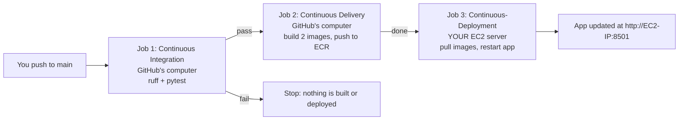
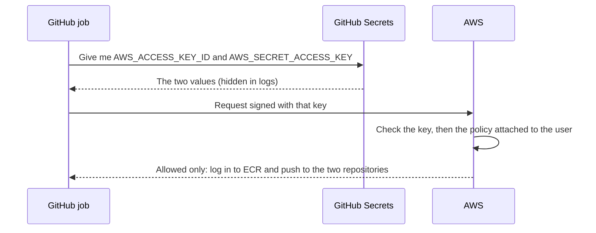
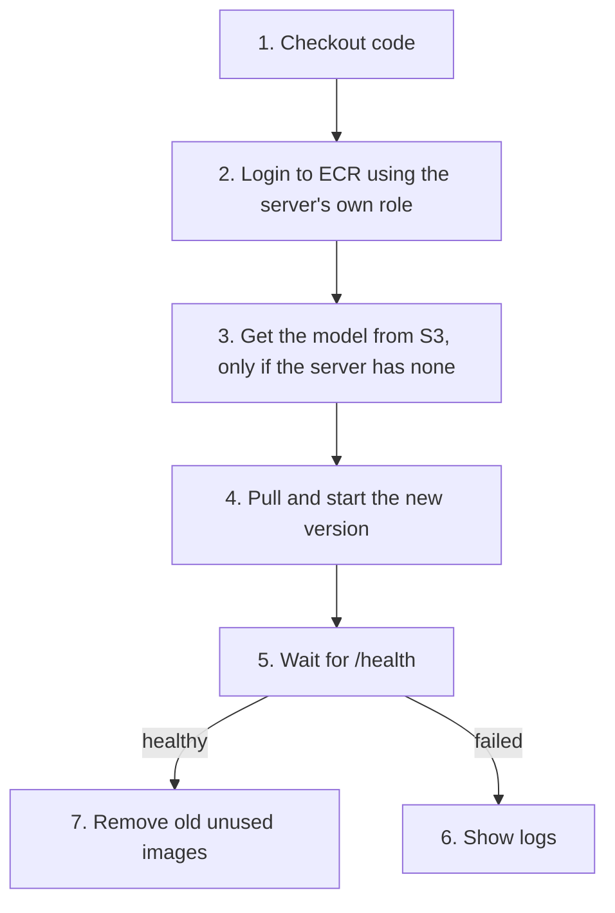

# The CI/CD workflow explained

The file [.github/workflows/cicd.yaml](../.github/workflows/cicd.yaml) is a **robot recipe** that GitHub follows every time you push code. This guide explains it from the top, with no prior knowledge needed.

## 1. What do CI and CD mean?

| Word | Stands for | In this project |
|---|---|---|
| **CI** | Continuous Integration | Every change is automatically checked: lint (tidy code) and tests |
| **CD** | Continuous Delivery / Deployment | If the checks pass, the app is packaged into Docker images, stored in AWS, and started on the server |

Why bother? Nobody has to remember to run the tests, and nothing untested reaches the server.

## 2. The whole picture



**Jobs** are big stages. Each job runs on its own computer (a **runner**), and the jobs run one after another because of `needs:`.

| Job (name in the file) | Runs on | When |
|---|---|---|
| `integration` | `ubuntu-latest`: a fresh free Linux machine from GitHub | Every push to `main` and every pull request |
| `build-and-push-ecr-image` | `ubuntu-latest` | Only after `integration` passes, and only for pushes to `main` |
| `Continuous-Deployment` | `self-hosted`: **your own EC2 server** running the GitHub runner program | Only after the build job finishes, and only for pushes to `main` |

## 3. YAML in 60 seconds

The workflow is written in YAML, a format made of indented lists and key/value pairs.

```yaml
jobs:                      # a key
  integration:             # a job called "integration"
    steps:                 # a list of steps...
      - name: Lint code    # ...each item starts with a dash
        run: uv run ruff check .   # "run" = type this command in a terminal
      - name: Checkout
        uses: actions/checkout@...  # "uses" = run a ready-made action someone else wrote
```

- Indentation (spaces, never tabs) shows what belongs to what.
- `run:` runs a shell command. `uses:` runs a packaged **action**.
- `${{ ... }}` is a GitHub **expression**: a value GitHub fills in, such as a secret or the commit ID.

## 4. The top of the file

### 4.1 `name`
```yaml
name: CI/CD
```
The title you see in the **Actions** tab on GitHub.

### 4.2 `on`: when does it run?
```yaml
on:
  push:
    branches: [main]
    paths-ignore: ['README.md', 'docs/**']
  pull_request:
    branches: [main]
    paths-ignore: ['README.md', 'docs/**']
```

| Event | Meaning |
|---|---|
| `push` to `main` | Code landed on the main branch |
| `pull_request` into `main` | Someone proposes a change; GitHub runs the checks on it before you merge |
| `paths-ignore` | If a change touches **only** `README.md` or files under `docs/`, the workflow is skipped. No point testing and redeploying for a typo in a document. If the change also touches code, it runs |

### 4.3 `permissions`: least privilege
```yaml
permissions:
  contents: read
```
Every job gets a temporary GitHub token. This line limits it to **read-only** access to the repository. A job that needs more can ask for it itself.

### 4.4 `concurrency`: no pile-ups
```yaml
concurrency:
  group: ${{ github.workflow }}-${{ github.ref }}
  cancel-in-progress: ${{ github.event_name == 'pull_request' }}
```
Runs in the same **group** (this workflow on this branch) do not overlap.
- For **pull requests**, a new push cancels the older run: only the latest code matters.
- For **pushes to `main`**, a new run waits instead of cancelling, so a deployment is never killed half way. (GitHub keeps at most one waiting run per group.)

### 4.5 The comment about pinning
```yaml
# Third-party actions are pinned to full commit SHAs
```
Look at a `uses:` line:
```yaml
uses: actions/checkout@3d3c42e5aac5ba805825da76410c181273ba90b1 # v7.0.1
```
The long code is a **commit SHA**: an exact, unchangeable version of that action's code. A tag like `@v7` can be moved by the action's owner (or an attacker who breaks into their account), which would run different code with your secrets. A SHA cannot be moved. The comment keeps the human-readable version. Dependabot can propose updates.

## 5. Job 1: `integration` (lint + tests)

```yaml
integration:
  name: Continuous Integration
  runs-on: ubuntu-latest
  steps: ...
```

| Step | What it does | Why |
|---|---|---|
| **Checkout code** (`actions/checkout`) | Downloads your repository onto the fresh machine | The machine starts empty. `persist-credentials: false` stops it leaving the GitHub token in the git settings |
| **Install uv** (`astral-sh/setup-uv`) | Installs `uv`, the Python package tool | The project uses `uv` for dependencies |
| **Install dependencies**: `uv sync --frozen` | Installs exactly the versions in `uv.lock` | `--frozen` means "do not look for newer versions"; the CI sees the same versions you tested |
| **Lint code**: `uv run ruff check app/api app/cloud app/pipeline/batch_pipeline.py frontend tests` | Checks code style and simple mistakes | Catches unused imports, long lines, bad import order |
| **Run unit and integration tests**: `uv run pytest -q` | Runs the 56 tests | Proves the code still works |

If any step fails, the job fails, and because the later jobs say `needs: integration`, **they never start**.

The tests need no secrets: MongoDB, DagsHub and AWS are faked (see [testing.md](testing.md)).

> **Keep in sync:** the list of linted folders appears here **and** in `LINTED_PATHS` in `tests/test_lint.py`. If you add a folder, change both.

## 6. Job 2: `build-and-push-ecr-image` (package the app)

```yaml
needs: integration
if: github.event_name == 'push'
```
- `needs: integration`: wait for the tests, and skip if they failed.
- `if: github.event_name == 'push'`: skip on pull requests, so a proposed change never builds images or touches AWS.

### 6.1 Checkout
Same as before: download the code.

### 6.2 Log in to AWS with the IAM user's key
```yaml
- uses: aws-actions/configure-aws-credentials@... # v6.3.0
  with:
    aws-access-key-id: ${{ secrets.AWS_ACCESS_KEY_ID }}
    aws-secret-access-key: ${{ secrets.AWS_SECRET_ACCESS_KEY }}
    aws-region: ${{ secrets.AWS_REGION }}
```
This step puts an **access key** (like a username and password for a robot) into the job's environment, so every later AWS command is done as the IAM user `github-actions-ecr-push`.



The safety net is the **policy attached directly to that user**: it only allows pushing images to the two ECR repositories. Even if the key leaked, it could not touch EC2, S3 or anything else. Treat the key like a password: keep it only in GitHub secrets, rotate it about every 90 days, and delete it if you suspect a leak.

### 6.3 Log in to ECR
```yaml
- id: login-ecr
  uses: aws-actions/amazon-ecr-login@... # v2.2.0
```
Docker needs to sign in to the image storage (ECR) before it can push. `id: login-ecr` gives this step a name so later steps can read its output, `steps.login-ecr.outputs.registry`: the registry address like `123456789012.dkr.ecr.ap-southeast-1.amazonaws.com`.

### 6.4 Build and push both images
```yaml
env:
  ECR_REGISTRY: ${{ steps.login-ecr.outputs.registry }}
  BACKEND_REPO: ${{ secrets.ECR_REPOSITORY_NAME }}
  FRONTEND_REPO: ${{ secrets.ECR_FRONTEND_REPOSITORY_NAME }}
  IMAGE_SHA: ${{ github.sha }}
run: |
  docker build -t "$ECR_REGISTRY/$BACKEND_REPO:$IMAGE_SHA" -t "$ECR_REGISTRY/$BACKEND_REPO:latest" .
  docker build -f frontend/Dockerfile -t "$ECR_REGISTRY/$FRONTEND_REPO:$IMAGE_SHA" -t "$ECR_REGISTRY/$FRONTEND_REPO:latest" .
  docker push --all-tags "$ECR_REGISTRY/$BACKEND_REPO"
  docker push --all-tags "$ECR_REGISTRY/$FRONTEND_REPO"
```

| Piece | Explanation |
|---|---|
| `docker build ... .` | Builds the backend image from the root `Dockerfile` (the `.` means "this folder") |
| `docker build -f frontend/Dockerfile ... .` | Builds the frontend image from its own Dockerfile |
| `-t name:tag` | Gives the image a name and a **tag**. Each image gets two tags |
| tag `$IMAGE_SHA` | The commit ID, for example `7e977ab...`. Unique and permanent: this is what the server runs, and what you roll back to |
| tag `latest` | A moving label for "the newest build" |
| `docker push --all-tags repo` | Uploads every local tag of that repository to ECR |
| `env:` block | Passes values in as environment variables instead of writing `${{ secrets... }}` inside the script. This stops a bad value from being run as code (script injection) |

## 7. Job 3: `Continuous-Deployment` (start it on the server)

```yaml
needs: build-and-push-ecr-image
if: github.event_name == 'push'
runs-on: self-hosted
concurrency:
  group: deploy-production
  cancel-in-progress: false
```
- `runs-on: self-hosted`: this job runs on **your EC2 server**, where you installed the GitHub runner program. It can see the server's Docker and files.
- `concurrency` (job level): only one deploy at a time, and a running deploy is **never** cancelled.



### Step 1: Checkout
Downloads the repository into the runner's work folder. We need `docker-compose.yml` and `scripts/` from it.

### Step 2: Login to ECR
```bash
ACCOUNT_ID="$(aws sts get-caller-identity --query Account --output text)"
REGISTRY="$ACCOUNT_ID.dkr.ecr.$AWS_REGION.amazonaws.com"
aws ecr get-login-password --region "$AWS_REGION" | docker login --username AWS --password-stdin "$REGISTRY"
echo "ECR_REGISTRY=$REGISTRY" >> "$GITHUB_ENV"
```
- No secrets are involved: the EC2 server has an **instance role** (`netsec-ec2-role`) that AWS gives to the machine itself.
- Line 1 asks AWS "who am I?" to get the account number. Line 2 builds the registry address. Line 3 gets a short-lived password and passes it straight to `docker login`.
- The last line saves `ECR_REGISTRY` into `$GITHUB_ENV`, a special file. Everything written there becomes an environment variable for **the following steps**, so `docker compose` can use it.

### Step 3: Get the model from S3 if the server has none
```bash
test -f /opt/netsec/.env || { echo "Missing /opt/netsec/.env"; exit 1; }
BUCKET="$(grep -E '^TRAINING_BUCKET_NAME[[:space:]]*=' /opt/netsec/.env | head -1 | cut -d= -f2- | tr -d "\"' ")"
bash scripts/fetch_latest_model.sh "$BUCKET" /opt/netsec/final_models
```
- `test -f ... || { ...; exit 1; }` means: "if the file is missing, print a message and **stop with an error**".
- The `BUCKET=` line reads one value from the server's `.env` file. It does not load the whole file on purpose: some lines (like the MongoDB address with `&`) would break the shell.
- [fetch_latest_model.sh](../scripts/fetch_latest_model.sh) does nothing if `model.pkl` and `preprocessor.pkl` are already there. Otherwise it finds the newest model folder in S3 (by upload time) and downloads it.
- The free-tier server never trains, so this is how the model gets there.

### Step 4: Pull and start the new version
```bash
cp docker-compose.yml /opt/netsec/docker-compose.yml
cd /opt/netsec
test -f .env || { echo "Missing /opt/netsec/.env"; exit 1; }
docker compose pull
docker compose up -d --remove-orphans
```
- `/opt/netsec` is the app's home on the server. It holds the secret `.env` and the folders `final_models`, `Artifacts`, `logs`. It is **outside** the runner's work folder because `checkout` cleans that folder and would delete untracked files like `.env`.
- `docker compose pull`: download the new images from ECR. Only layers that changed are downloaded.
- `docker compose up -d`: start (or replace) the containers in the background. `--remove-orphans` removes containers of services that no longer exist in the file.
- `IMAGE_TAG: ${{ github.sha }}` (from the step's `env:`) tells the compose file to run **this exact commit's** images, not `latest`.

### Step 5: Wait for the API to be healthy
```bash
curl -fsS --retry 30 --retry-delay 5 --retry-connrefused http://127.0.0.1:8000/health
```
After starting, the API needs a little time to load. `curl` asks `/health` and tries again every 5 seconds, up to 30 times (about 2.5 minutes). `-f` makes `curl` fail on an HTTP error, so the step (and the job) fails if the API never becomes healthy.

### Step 6: Show logs if the deploy failed
```yaml
if: failure()
run: cd /opt/netsec && docker compose ps && docker compose logs --tail=100
```
`if: failure()` makes this step run **only when an earlier step failed**. It prints the container status and the last 100 log lines into the GitHub log, so you can see why without logging in to the server.

### Step 7: Remove old unused images
```bash
docker image prune -af
```
Every deploy leaves the previous version's images on disk (about 1 GB). On a small disk that adds up. `-a` removes all images no container is using; `-f` skips the confirmation. A rollback simply downloads the old tag from ECR again.

## 8. Which secrets does it need?

GitHub, repository, **Settings, Secrets and variables, Actions**:

| Secret | Used by | Meaning |
|---|---|---|
| `AWS_ACCESS_KEY_ID` | build job | Access key ID of the IAM user `github-actions-ecr-push` |
| `AWS_SECRET_ACCESS_KEY` | build job | The matching secret key |
| `AWS_REGION` | build and deploy jobs | For example `ap-southeast-1` |
| `ECR_REPOSITORY_NAME` | build and deploy | Name of the backend ECR repository |
| `ECR_FRONTEND_REPOSITORY_NAME` | build and deploy | Name of the frontend ECR repository |

Only the build job uses an access key. The deploy job runs on your server and uses the server's own IAM role, so no key is stored there. The setup is in [aws_deployment.md](aws_deployment.md).

## 9. Security choices at a glance

| Choice | Protects against |
|---|---|
| Actions pinned to commit SHAs | A tag being moved to malicious code |
| A tiny policy on the IAM user (push to two repos only) | A leaked access key being used for anything else |
| `permissions: contents: read` by default | A job doing more than it needs |
| `persist-credentials: false` | The GitHub token lingering on the machine |
| Values passed through `env:` | Script injection through secrets or other inputs |
| Build and deploy only on `push` to `main` | Pull requests (including from forks) reaching AWS or your server |
| Deploy lock (`concurrency`) | Two deploys fighting over one server |

> The self-hosted runner executes workflow code on your server. Keep **Require approval for fork pull requests** switched on, and never let the deploy job run for pull requests.

## 10. Reading a run and fixing failures

On GitHub: **Actions** tab, click a run, click a job, click a step to see its log. **Re-run all jobs** (top right) tries again.

| Where it failed | Likely cause |
|---|---|
| Lint code | A style problem. Run `uv run ruff check <paths> --fix` locally |
| Run tests | A test broke. Run `uv run pytest -x -q` locally |
| Configure AWS credentials | The two key secrets are wrong or have stray spaces, or the key was deactivated or deleted |
| Login to Amazon ECR / push | The `ecr-push-network-security` policy is not attached to the user, or a repository name differs from the secret |
| Job waits forever "Waiting for a runner" | The runner on EC2 is offline: `sudo ./svc.sh status` in the runner folder |
| Missing `/opt/netsec/.env` | Create it on the server (see [aws_deployment.md](aws_deployment.md)) |
| Wait for the API to be healthy | The app crashed. Read the logs printed by Step 6 (Mongo access list, bad `.env` values, out of memory) |

**Rollback:** the workflow does **not** roll back automatically. If a bad version gets deployed, run an older commit's images by hand on the server:
```bash
cd /opt/netsec
IMAGE_TAG=<an older commit sha> docker compose up -d     # needs the ECR_* variables, see aws_deployment.md
```

## 11. Common changes

| I want to... | Change |
|---|---|
| Add a check before deploy | Add a step to the `integration` job, for example `run: uv run mypy app` |
| Lint another folder | Add it to the `ruff check` line **and** to `LINTED_PATHS` in `tests/test_lint.py` |
| Deploy from another branch | Change `branches: [main]` under `push` |
| Skip CI for more file types | Add patterns to `paths-ignore` |
| Add a third image | Add an ECR repo and a secret, a build and push line, and a service in `docker-compose.yml` |
| Update an action | Look up the new release's commit SHA (`git ls-remote --tags https://github.com/<owner>/<action>`), replace the SHA and the version comment |

## 12. Glossary

| Term | Meaning |
|---|---|
| **Workflow** | The whole YAML file |
| **Job** | A group of steps on one machine |
| **Step** | One command (`run`) or one action (`uses`) |
| **Runner** | The machine that runs a job: GitHub-hosted (`ubuntu-latest`) or your own (`self-hosted`) |
| **Action** | A reusable packaged step written by someone else |
| **Secret** | A hidden value stored in GitHub settings, never shown in logs |
| **SHA** | The unique ID of one exact commit |
| **ECR** | AWS's private storage for Docker images |
| **IAM user** | An AWS identity for a person or program. Here: the robot that pushes images |
| **Access key** | The ID and secret that let a program act as an IAM user |
| **IAM role** | A set of AWS permissions that something can temporarily take on |
| **Tag** | A label on a Docker image, such as `latest` or a commit SHA |
