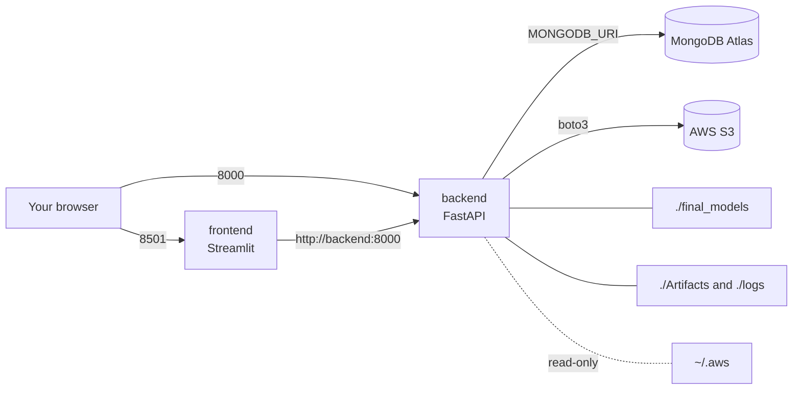

# docker-compose explained (local development)

[docker-compose.local.yml](../docker-compose.local.yml) starts the whole app on your computer with one command instead of typing `docker build` and `docker run` for each piece.

> The plain `docker-compose.yml` is the **AWS** stack (it pulls images from ECR). See [aws_deployment.md](aws_deployment.md). Everything below is about the local file.

```bash
docker compose -f docker-compose.local.yml up --build
```

**Shortcut:** add the line `COMPOSE_FILE=docker-compose.local.yml` to your local `.env`. Then plain `docker compose up --build`, `docker compose logs -f` and the other commands in this guide use the local file automatically.

| Open | What you get |
|---|---|
| http://localhost:8501 | Streamlit UI |
| http://localhost:8000/docs | FastAPI Swagger page |

## 1. The picture



Compose puts the services on one private network. They reach each other **by service name**: the UI calls `http://backend:8000`, not `localhost`.

## 2. Service: `backend`

| Key | What it means |
|---|---|
| `build: .` | Build the image from the `Dockerfile` in this folder |
| `ports: "127.0.0.1:8000:8000"` | `host address : host port : container port`. Reachable at `localhost:8000` from your machine only |
| `env_file: .env` | Loads your `.env` into the container (Mongo, DagsHub, MLflow, bucket name). The file is **not** copied into the image |
| `environment: AWS_*` | Tells boto3 where the mounted AWS credentials are |
| `volumes: ./app:/app/app` | Shares your code folder with the container, so saving a file updates the running app |
| `volumes: ./final_models` | The trained model lives on your disk and survives container restarts. Training in the container replaces it, and the API hot-reloads it |
| `volumes: ./Artifacts` and `./logs` | Pipeline outputs and logs appear in your project folder |
| `volumes: ~/.aws:...:ro` | Your `aws configure` credentials, mounted **read-only** so the S3 upload works without copying keys anywhere |
| `command: ... --reload` | Restarts the server when code changes. For development only, and still one worker |
| `restart: unless-stopped` | Come back up after a crash |

## 3. Service: `frontend`

| Key | What it means |
|---|---|
| `build: context/dockerfile` | Build from the repo root using `frontend/Dockerfile` |
| `environment: API_URL` | Where the UI sends requests |
| `volumes: ./frontend` | Live code: Streamlit reloads when you save |
| `depends_on: backend: condition: service_healthy` | Wait until the backend's healthcheck passes before starting the UI |

## 4. Database

There is no database container. The backend connects to your cloud MongoDB (Atlas) through `MONGODB_URI` in `.env`. Make sure your current IP is allowed in Atlas, Network Access.

## 5. Daily commands

| Command | Does |
|---|---|
| `docker compose up --build` | Build if needed and start (add `-d` to run in the background) |
| `docker compose logs -f backend` | Follow one service's logs |
| `docker compose ps` | Show status and health |
| `docker compose restart backend` | Restart one service |
| `docker compose down` | Stop and remove containers (your files in the mounted folders stay) |
| `docker compose build --no-cache` | Rebuild from scratch |

## 6. Things to set up first

Every published port is bound to `127.0.0.1`, so only your own machine can reach the API and the UI. Without that binding, Docker publishes ports on all network interfaces and anyone on your network could reach them.

- **`.env`** must exist (copy `.env.example`). Write each line as `KEY=value` with **no spaces around `=`**. Your file currently has `TRAINING_BUCKET_NAME =...`, so remove the space before `=`.
- **Training (`POST /train`) in the container** needs a DagsHub token because there is no browser to log in with. Add `DAGSHUB_USER_TOKEN=<your token>` to `.env`. It also needs the S3 bucket and `aws configure` already done on your machine.
- **Never commit `.env`** or put keys in the compose file.
- **Changing dependencies** (`uv add ...`) needs `docker compose up --build` again. Code changes do not.

## 7. Troubleshooting

| Problem | Fix |
|---|---|
| UI says "Cannot reach API" | Check `docker compose ps`; the backend must be `healthy`. Look at `docker compose logs backend` |
| Backend `unhealthy` | The health check hits `/health`. The first start can take up to about 40 s while the model loads |
| `/predict` returns 503 "Model not loaded" | `./final_models` is empty. Train once (UI **Train** tab) or copy a trained model into `final_models/` |
| `NoCredentialsError` (S3) | Run `aws configure` on your machine. Check `~/.aws` is mounted. If `~/.aws` is a symlink (for example into `/mnt/c/...` on WSL), mount the real path instead |
| Permission denied writing to `Artifacts` or `logs` | The container user is UID 1000. Run `sudo chown -R 1000:1000 Artifacts logs final_models`, or use your own UID |
| Port already in use | Change the left number, for example `"8001:8000"`, and update the URL you open |
| Code changes do not show up | Make sure you started with `docker compose up` (the code is mounted), not `docker run` |
| `docker: command not found` in WSL | Turn on WSL integration: Docker Desktop, Settings, Resources, WSL integration |
