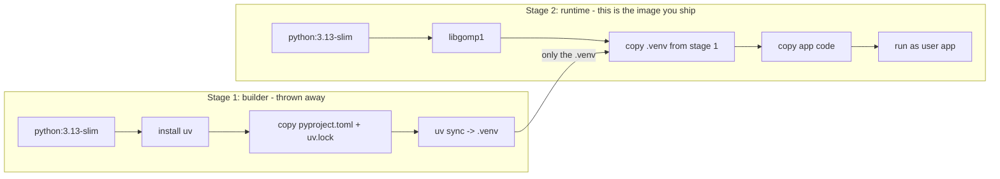
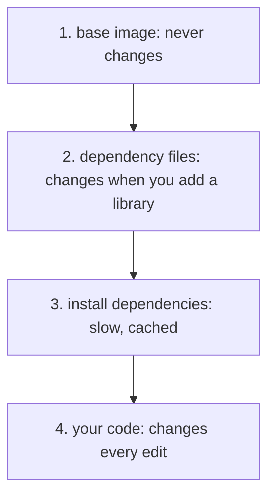

# Docker images explained (backend and frontend)

Two images, each built from its own Dockerfile:

| Image | File | What runs inside | Port |
|---|---|---|---|
| Backend | [Dockerfile](../Dockerfile) | FastAPI + the ML code | 8000 |
| Frontend | [frontend/Dockerfile](../frontend/Dockerfile) | Streamlit UI | 8501 |

## 1. What is a Dockerfile?

A recipe. Docker reads it top to bottom and builds an **image** (a frozen copy of Python, your libraries and your code). Running an image gives you a **container**. Each instruction becomes a **layer**, and Docker caches layers.

## 2. The trick that keeps images small: two stages



Stage 1 has the installer and its download cache. Stage 2 copies only the finished `.venv`, so that clutter never reaches the final image.

## 3. The backend Dockerfile, line by line

| Line | In plain words |
|---|---|
| `FROM python:3.13-slim AS builder` | Start from a minimal Python (about 120 MB, not the 1 GB full image) and name this stage "builder" |
| `COPY --from=ghcr.io/astral-sh/uv:0.11.26 /uv /bin/uv` | Grab the `uv` tool from its official image. Pinned to a version so builds are repeatable |
| `ENV UV_LINK_MODE=copy` | Copy files into the venv instead of linking (links break between stages) |
| `COPY pyproject.toml uv.lock ./` | Copy **only** the dependency list first |
| `RUN --mount=type=cache ... uv sync --frozen --no-default-groups --no-install-project` | Install exactly what `uv.lock` says. `--no-default-groups` skips dev tools and the Streamlit group. `--no-install-project` because the app code is copied later. The cache mount speeds up rebuilds without being stored in the image |
| `FROM python:3.13-slim` | Stage 2 starts again from a clean minimal Python |
| `apt-get install --no-install-recommends libgomp1` | One system library that xgboost and scikit-learn need. `rm -rf /var/lib/apt/lists/*` deletes the package index so it does not bloat the layer |
| `useradd --uid 1000 app` and `USER app` | Run as a normal user. If the app is hacked, it is not root. UID 1000 usually matches your own user, so files written to mounted folders belong to you |
| `ENV PATH=... PYTHONUNBUFFERED=1 PYTHONDONTWRITEBYTECODE=1` | Use the venv's Python. Print logs immediately. Skip `.pyc` files (smaller, cleaner) |
| `COPY --from=builder /app/.venv /app/.venv` | Bring in the installed libraries from stage 1 |
| `COPY app ./app` and `COPY data_schema ./data_schema` | Your code, copied **last** because it changes most often |
| `mkdir -p final_models Artifacts logs` | Folders the app writes to. They are not baked in with data; compose mounts your real folders on top |
| `HEALTHCHECK ...` | Docker calls `/health` every 30 s and marks the container `healthy` or `unhealthy` |
| `CMD ["uvicorn", ...]` | The start command. **One worker**, because training status lives in memory |

### The layer-cache rule

Put things that change **rarely** first and **often** last:



Edit a `.py` file and only step 4 rebuilds (seconds). Add a library and steps 2 and 3 rebuild.

## 4. The frontend Dockerfile

Same pattern, with three differences:
- It installs `--only-group frontend`: Streamlit, httpx, pandas and pyyaml. No scikit-learn, mlflow or xgboost, so it is a small fraction of the backend's size.
- It copies `frontend/` and just `data_schema/schema.yaml` (the UI reads the 30 column names from it).
- `API_URL=http://backend:8000` tells the UI where the API is. `backend` is the compose service name.

Build it from the **repo root** (it needs `uv.lock`):
```bash
docker build -f frontend/Dockerfile -t netsec-frontend .
```

## 5. [.dockerignore](../.dockerignore): what never enters the image

Docker sends your project folder to the builder first. The ignore file keeps out:
- **`.env`**: your secrets. Passed at run time instead, never baked in.
- **`.venv` (1+ GB), `Artifacts`, `mlruns`, `logs`, `final_models`, `notebooks`, `.git`**: huge or runtime-only.

## 6. Why it is small: summary

| Choice | Saves |
|---|---|
| `python:3.13-slim` base | the full `python` image is about 1 GB; slim is about 120 MB |
| Two stages (no uv, no caches in the final image) | build clutter stays out |
| Removed `apache-airflow` and `dvc` from the dependencies (the app never imported them) | a big dependency tree (Airflow alone pulls in hundreds of packages) |
| `xgboost-cpu` on Linux (the default wheel adds NVIDIA NCCL GPU libraries) | a GPU library this CPU-only app never uses |
| Frontend has its own tiny dependency group | the UI image has about 90 MB of libraries, not about 1 GB |
| `.dockerignore`, no `.pyc`, apt lists removed | the rest |

Measured with `uv sync` in a scratch folder: **backend libraries about 975 MB, frontend libraries about 89 MB**, plus about 120 MB for the Python base. So expect roughly 1.1 GB for the backend and 0.2 GB for the frontend. The backend is still big because MLflow, Evidently and scikit-learn bring heavy dependencies of their own (pyarrow about 166 MB, plotly about 102 MB, scipy about 92 MB). Check the real numbers with `docker images`.

Ways to go smaller, if you ever need it: serve predictions from a separate image without training libraries, or switch to `mlflow-skinny`. Both change what the container can do, so they are not done here.

## 7. Build and run one image by hand

```bash
docker build -t netsec-backend .
docker images netsec-backend                       # check the size

docker run --rm -p 8000:8000 --env-file .env \
  -v "$PWD/final_models:/app/final_models" netsec-backend
curl http://localhost:8000/health
```

For both services together, use compose: see [docker_compose.md](docker_compose.md).
