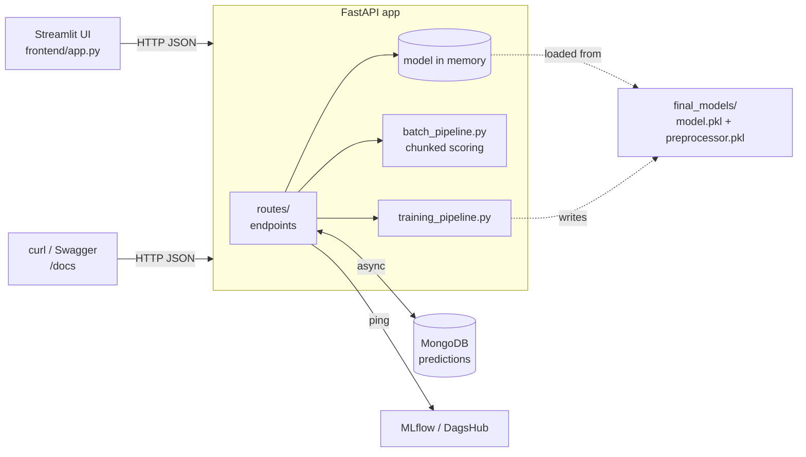
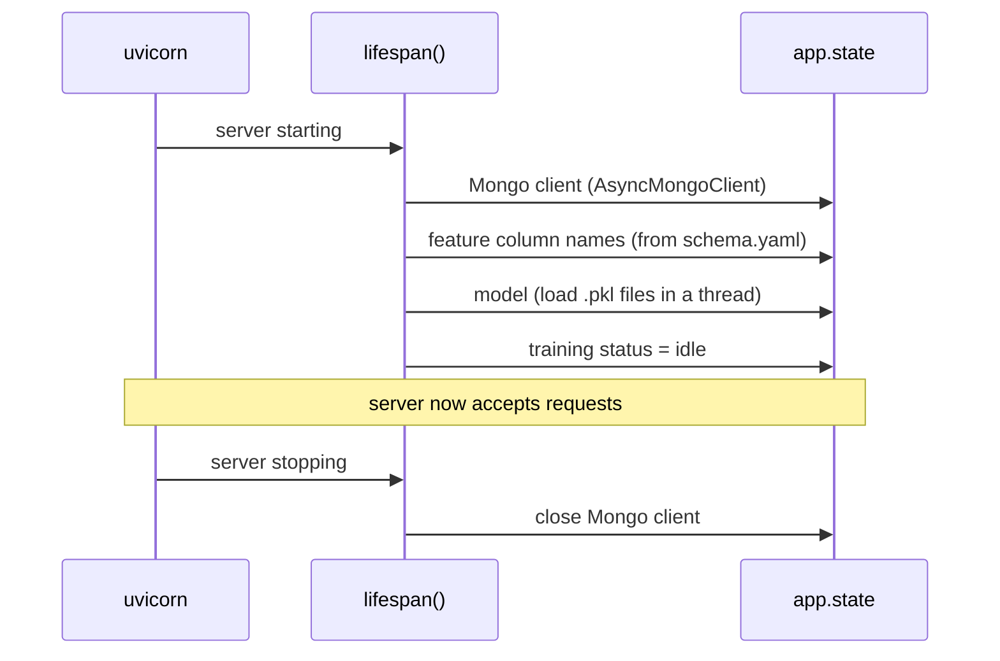
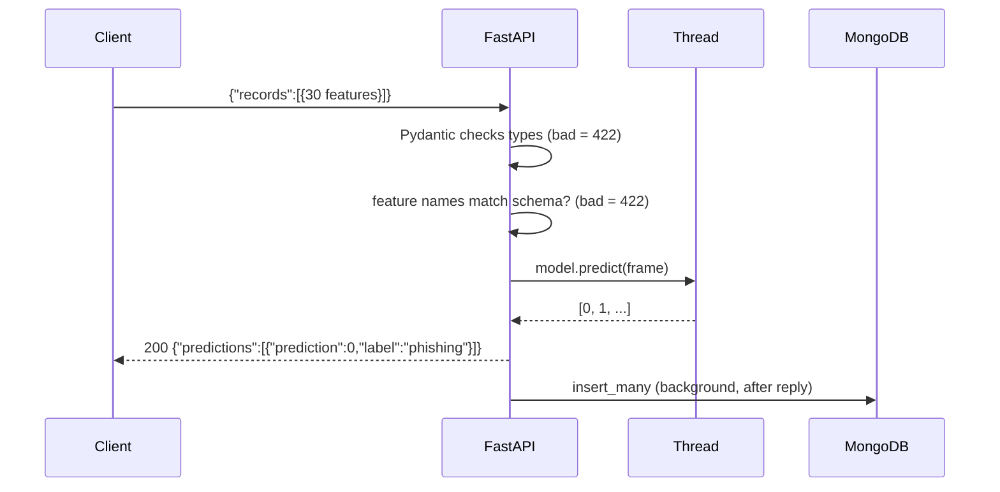
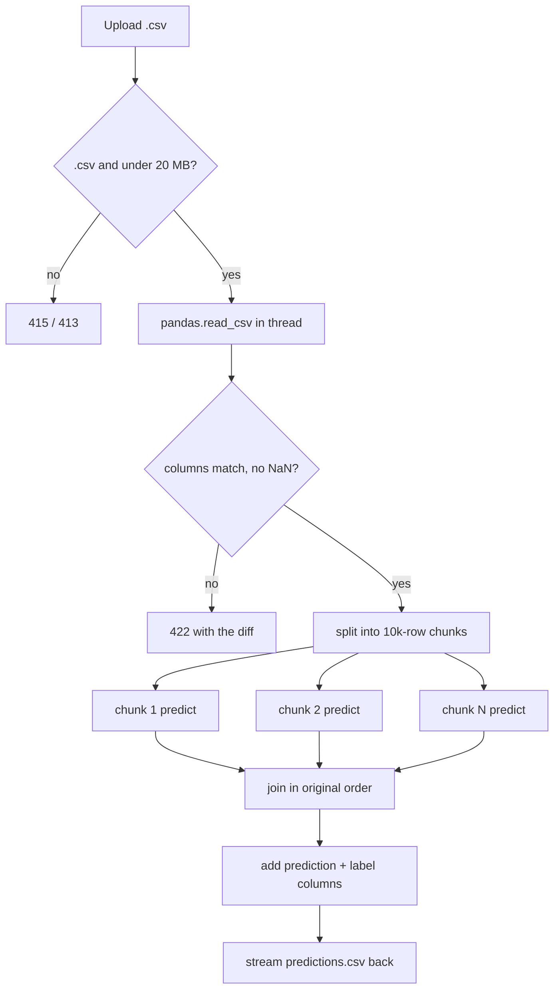
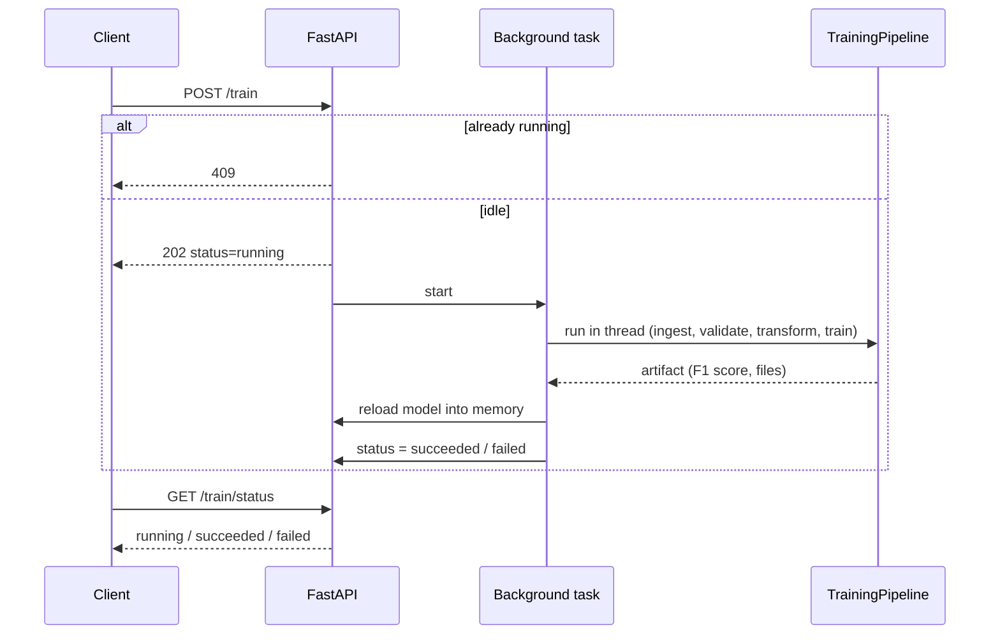

# How the FastAPI backend works

A beginner-friendly tour of [app/api/](../app/api/). Read top to bottom, about 10 minutes.

## 1. The big picture

FastAPI turns Python functions into web endpoints. A client (the Streamlit UI, `curl`, a browser) sends an HTTP request. FastAPI calls the matching function and sends back JSON.



## 2. File map

| File | Job |
|---|---|
| [main.py](../app/api/main.py) | Creates the `app`, runs startup/shutdown code (the "lifespan"), plugs in the routes |
| [schemas.py](../app/api/schemas.py) | Pydantic models: the exact shape of every request and response |
| [deps.py](../app/api/deps.py) | Shared helpers: load the model, current time |
| [routes/health.py](../app/api/routes/health.py) | `GET /health` |
| [routes/predict.py](../app/api/routes/predict.py) | `POST /predict` |
| [routes/predictions.py](../app/api/routes/predictions.py) | `GET /predictions` (history) |
| [routes/batch.py](../app/api/routes/batch.py) | `POST /batch/predict` (CSV in, CSV out) |
| [routes/train.py](../app/api/routes/train.py) | `POST /train`, `GET /train/status` |
| [pipeline/batch_pipeline.py](../app/pipeline/batch_pipeline.py) | Scoring logic for batches, no FastAPI inside |

Why one file per endpoint group? Each file stays short, and `routes/__init__.py` joins them into one `api_router`.

## 3. Startup: the lifespan

Heavy things are created **once** when the server starts, not on every request. That lives in `lifespan` in `main.py`:



`app.state` is just a shared notebook. Endpoints reach it through `request.app.state.model`, `request.app.state.predictions`, and so on.

If `final_models/` is empty, the API still starts. `/predict` answers `503` until you train.

## 4. What "async" means here

- `async def` endpoints run on one event loop. While one request waits (database, network), the loop serves others.
- `await` marks the waiting point.
- Sklearn and pandas are **blocking** (they hog the CPU). Calling them directly would freeze every other request. So we wrap them: `await asyncio.to_thread(model.predict, frame)`. It runs in a worker thread and the loop stays free.
- `asyncio.gather(a(), b())` starts two waits at the same time. Total time is the slowest one, not the sum.

Where it is used:

| Place | What runs in parallel |
|---|---|
| `GET /health` | MongoDB ping + MLflow ping |
| `GET /predictions` | `count_documents` + the page of rows |
| `POST /batch/predict` | Chunks of 10,000 rows scored in a thread pool |
| `POST /predict` | Mongo logging runs *after* the response (BackgroundTasks) |

## 5. Request walkthrough: `POST /predict`



Key ideas in `routes/predict.py`:
- `body: PredictRequest` makes FastAPI parse and validate the JSON for you. No manual parsing.
- `response_model=PredictResponse` makes FastAPI check and shape what you return.
- `HTTPException(503, ...)` becomes a proper HTTP error with a message.
- `background.add_task(...)` runs after the reply, so the user does not wait for Mongo. If the insert fails it is logged, not raised.

Label meaning: `1` = legitimate, `0` = phishing. (Transformation maps the dataset's `-1` to `0`.)

## 6. Batch: `POST /batch/predict`



`predict_frame()` in `batch_pipeline.py` is a plain function with no FastAPI in it. That makes it easy to test alone.

## 7. Training: `POST /train`

Training takes minutes, so the endpoint does not wait for it.



After success the new model is hot-swapped. No server restart needed.

Limits to know: status lives in memory, so run **one** uvicorn worker. The trainer imports DagsHub when it loads, so the pipeline is imported lazily inside the thread. That way the API starts even if DagsHub is down.

## 8. Error codes you will see

| Code | Meaning |
|---|---|
| 200 | OK |
| 202 | Training accepted, running in background |
| 409 | Training already running |
| 413 | Upload larger than 20 MB |
| 415 | Upload is not a `.csv` |
| 422 | Bad input: wrong types, wrong or missing features, bad CSV |
| 503 | No model loaded yet, or MongoDB down |

## 9. Try it

```bash
uv run uvicorn app.api.main:app --reload     # API on http://localhost:8000
# open http://localhost:8000/docs            # interactive Swagger page, click "Try it out"
uv run streamlit run frontend/app.py         # UI on http://localhost:8501
```

`curl` example:

```bash
curl http://localhost:8000/health
curl -X POST http://localhost:8000/batch/predict -F "file=@data/phisingData.csv" -o out.csv
```

## 10. Where to read the code first

1. [schemas.py](../app/api/schemas.py): small, shows what goes in and out.
2. [routes/predict.py](../app/api/routes/predict.py): the core flow.
3. [main.py](../app/api/main.py): how startup wires things.
4. [routes/train.py](../app/api/routes/train.py): background work.
