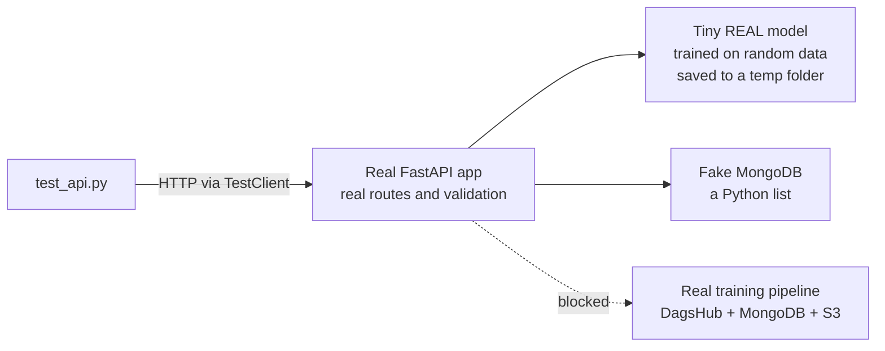

# Testing guide: unit, integration and lint

This project has **56 automated checks**. They run in about 2 seconds and need no internet, no MongoDB, no DagsHub and no AWS account.

```bash
uv run pytest                          # everything
uv run pytest tests/unit               # only unit tests (fastest)
uv run pytest -m integration           # only API tests
uv run pytest -m "not integration"     # everything except API tests
uv run pytest -k batch                 # only tests with "batch" in the name
uv run pytest -x -q                    # stop at first failure, short output
uv run ruff check app/api tests        # lint only
```

Green means: `56 passed`. Anything red tells you the file and line.

## 1. The three kinds of checks (simple version)

| Kind | Question it answers | Real-life comparison | Count |
|---|---|---|---|
| **Unit** | Does this one small function do the right thing? | Test a car's brake pedal on its own | 29 |
| **Integration** | Do the pieces work **together**? | Drive the car: pedal, engine and wheels together | 20 |
| **Lint** | Is the code tidy and free of silly mistakes? | Spell-check before sending an email | 1 |

The S3 tests (`tests/test_s3_syncer.py`) are unit-style tests of the boto3 uploader, using a fake S3.

## 2. Folder map

```
tests/
  conftest.py                 shared fixtures: schema columns, sample rows, a tiny trained model
  test_lint.py                runs ruff and fails if it finds problems
  test_s3_syncer.py           S3 upload/download against a fake S3 (moto)
  unit/
    test_batch_pipeline.py    predict_frame(): chunking, labels, bad input
    test_schemas.py           request/response validation, Swagger example stays valid
    test_entities.py          config paths and validation (Pydantic)
    test_utils.py             save/load helpers, schema.yaml, metrics, custom exception
  integration/
    conftest.py               fake MongoDB + the app wired to a tiny model + safety net
    test_api.py               every endpoint, through real HTTP calls to the real app
```

## 3. How a test looks (anatomy)

```python
def test_missing_feature_raises(frame, feature_columns):      # 1. name says what we expect
    with pytest.raises(ValueError, match="feature mismatch"):  # 3. what must happen
        predict_frame(StubModel(), frame.drop(columns=[...]), feature_columns)  # 2. do the thing
```

Every test is: **arrange** (build input), **act** (call the code), **assert** (check the result). `frame` and `feature_columns` are **fixtures**: reusable setup that pytest hands to any test that names it as a parameter.

## 4. Unit tests

| File | What it protects |
|---|---|
| `test_batch_pipeline.py` | Output has `prediction` and `label` columns. Label matches prediction. **Chunked scoring keeps row order** (a classic parallel bug). `Result` column is ignored. Missing or extra columns and NaN values raise a clear error. An empty file does not crash |
| `test_schemas.py` | Empty list, more than 1000 records and non-integer values are rejected. **The example shown in Swagger always matches `schema.yaml`**, so renaming a column fails the test instead of silently breaking the docs |
| `test_entities.py` | Run folder is `Artifacts/<timestamp>`. `model_dir` is `final_models` (the folder the trainer writes to and S3 uploads from). Stage paths sit under the run folder. A split ratio of 0 or above 1 is rejected. Configs cannot be changed after creation |
| `test_utils.py` | Save then load gives the same object, array and YAML. Loading a missing file raises the project's exception. `schema.yaml` has 31 columns including `Result`. Perfect predictions score 1.0. The custom exception keeps the original error and the line number |

`StubModel` (in `test_batch_pipeline.py`) is a fake model: "predict 1 if the first feature is positive". Using a fake keeps the test about the **pipeline logic**, not about scikit-learn.

## 5. Integration tests

They start the **real FastAPI app** and call it like a client would. Only the slow or external parts are replaced.



| Real in the test | Replaced |
|---|---|
| Routes, validation, error codes | MongoDB becomes `FakeMongoClient` (a list with the same async methods) |
| Model loading from `.pkl` files (`reload_model`) | The model is tiny, trained in a fixture, so no `final_models/` is needed |
| Background logging of predictions | `/train` runs a stub instead of the real pipeline |
| CSV upload and download | The settings (URIs) are fake strings |

What `test_api.py` covers:

| Area | Checks |
|---|---|
| `/health` | `ok`, degraded without a model, reports MongoDB down |
| `/predict` | Labels returned, rows logged to the database, same answer as calling the model directly, missing or extra feature gives 422, bad payload gives 422, no model gives 503 |
| `/predictions` | Paging and `total`, `limit=0` rejected |
| `/batch/predict` | Returns a CSV with 25 rows plus `prediction` and `label`, 415 for non-CSV, 422 for a missing column or empty file, 413 for an oversized file, 503 without a model |
| `/train` | Success updates the status and F1, failure is reported with its message, 409 if already running |
| Model reload | A model that appears later is loaded without restarting |

### The safety net

`integration/conftest.py` has an automatic fixture, `never_run_real_training`. It makes the real `_train_blocking` function raise an error. Real training reads your database, logs to DagsHub, **overwrites `final_models/`** and **uploads to S3**, so no test may ever start it by accident. Tests that need `/train` swap in their own stub, which takes priority.

Rule: if you add a test that touches `/train`, stub `_train_blocking`. Never call the real one.

### Are the tests actually able to fail?

Yes, and it is worth checking. When the code was deliberately broken (rows reversed, labels renamed, the "already running" guard removed), the matching tests failed. A test that cannot fail proves nothing.

## 6. Linting with ruff

Ruff reads code without running it and reports mistakes and messy style. Settings live in `pyproject.toml` under `[tool.ruff]`.

| Rule set | Catches | Example |
|---|---|---|
| `E`, `W` | Style: line over 100 characters, trailing spaces | a very long line |
| `F` | Real mistakes: unused imports, undefined names | `import os` that is never used |
| `I` | Import order | `import app...` placed before `import numpy` |

`tests/test_lint.py` runs ruff on these paths and fails the test run if anything is found:

`app/api`, `app/cloud`, `app/pipeline/batch_pipeline.py`, `frontend`, `tests`

The older modules (`app/components`, `app/utils`, and so on) are **not** linted yet, because they contain many old warnings and fixing them would change code unrelated to this work. To add a folder: fix its findings, then add its path to `LINTED_PATHS` in `tests/test_lint.py`.

```bash
uv run ruff check app/api tests             # show problems
uv run ruff check app/api tests --fix       # auto-fix the safe ones (imports, spaces)
uv run ruff check app --statistics          # how many problems per rule, whole app
```

## 7. Adding a new test

1. **Pure function?** Add a unit test under `tests/unit/`. Pass fake inputs, assert on the output.
2. **New endpoint?** Add to `tests/integration/test_api.py`. Use the `client` fixture and `make_rows(n)` for sample data.
3. Need a missing-model case? Use `no_model_client`.
4. Give the test a name that says the expected behaviour: `test_predict_rejects_extra_feature`.
5. Run it alone first: `uv run pytest tests/integration/test_api.py -k extra_feature`.
6. Then run everything, and `ruff check tests`.

Useful fixtures:

| Fixture | Gives you |
|---|---|
| `feature_columns` | The 30 feature names from `schema.yaml` |
| `make_rows(n, seed=0)` | `n` random valid rows (values -1, 0, 1) |
| `tiny_model_dir` | A temp folder with a real `model.pkl` and `preprocessor.pkl` |
| `client` | Running app, tiny model loaded, fake MongoDB |
| `no_model_client` | Running app with no model (nothing trained yet) |

## 8. Running it in CI (GitHub Actions)

`.github/workflows/cicd.yaml` runs the same checks on every push and pull request: `uv sync --frozen`, then `ruff check` on the linted paths, then `pytest -q`. The image build and deploy jobs run only after they pass, and only on pushes to `main`. See [aws_deployment.md](aws_deployment.md).

The tests need no secrets, because MongoDB, DagsHub and AWS are all faked. That is why they are safe to run on every push and on pull requests.

## 9. What is NOT tested (so you know the gaps)

- The **real** training pipeline end to end (needs MongoDB, DagsHub and AWS).
- Each pipeline stage's internals (ingestion, validation with Evidently, transformation, model trainer).
- The Streamlit UI.
- The Docker images and `docker compose`.
- Real connections to MongoDB Atlas and S3 (S3 is covered with a fake).

Good next tests: data transformation on a small CSV (`tests/unit`), and a stage-by-stage pipeline test on `data/phisingData.csv` with MLflow pointed at a temp folder.

## 10. Troubleshooting

| Problem | Fix |
|---|---|
| `test_ruff_check_passes` fails | Read the printed rule and file. Try `uv run ruff check <paths> --fix` |
| `FileNotFoundError: data_schema/schema.yaml` | Run pytest from the project root |
| `real training must never run inside tests` | Your test reached `/train` without a stub. Monkeypatch `train_route._train_blocking` |
| Fixture `client` not found | The test must live under `tests/integration/` (the fixture is defined there) |
| Test passes alone, fails with the others | Tests share state. Create fresh data in the test, never reuse module-level lists |
| `ModuleNotFoundError: moto` or `ruff` | Run `uv sync` (they are in the dev group) |
